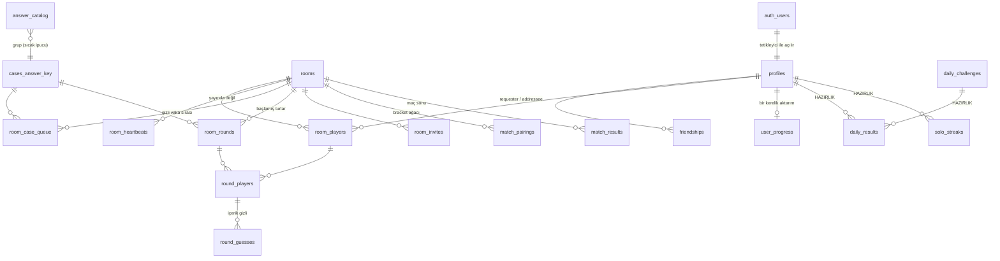
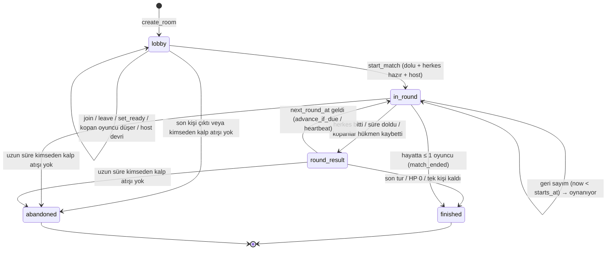
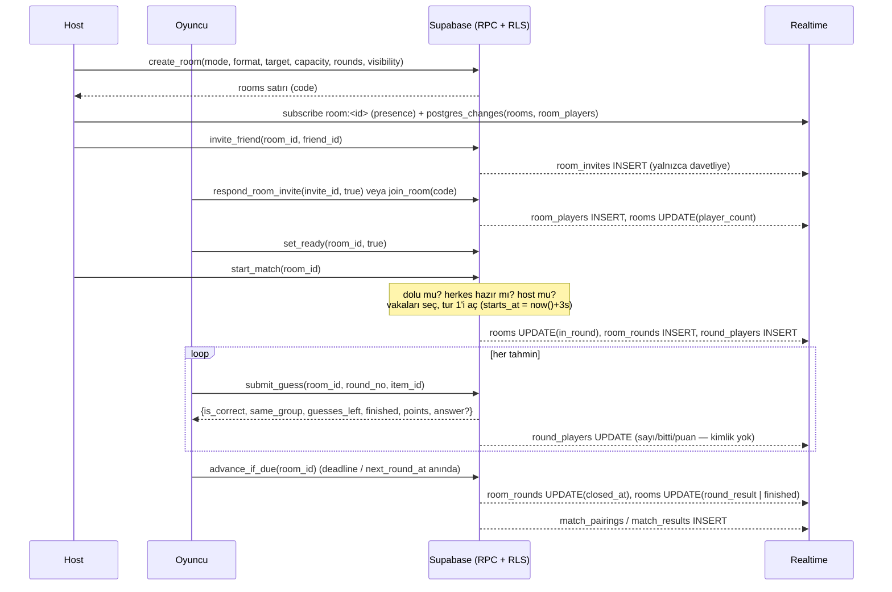

# PsikoVaka — Çevrimiçi katman tasarımı (Supabase)

Bu belge `migrations/0001_init.sql` dosyasının neyi, neden yaptığını anlatır ve istemci
(yeniden yazılacak `js/online_arena.js`) için sözleşmedir. Kurulum adımları `README.md`'de.

**Test durumu (0001–0002; 0003 için bkz. §13 ve README):** `tests/scenario.test.mjs` içindeki 44 senaryonun hepsi PGlite (PostgreSQL 18.6, WASM)
ve PostgreSQL 16.15 üzerinde geçti. Supabase'in sağladığı nesneler (`auth.users`, `auth.uid()`,
`realtime.messages`, `realtime.topic()`, roller, yayın) `tests/00_supabase_stubs.sql` ile taklit edildi.
Gerçek Supabase projesinde henüz çalıştırılmadı. Eşzamanlılık (iki isteğin aynı anda gelmesi)
kod düzeyinde satır kilitleriyle ele alındı ama ayrı bir yük/yarış testiyle denenmedi.

---

## 1. Temel ilkeler

- **Sunucu otoritesi.** İstemci hiçbir tabloya INSERT/DELETE yapamaz. Tek doğrudan yazma:
  `profiles.display_name` ve `profiles.avatar` (sütun düzeyinde yetki + RLS, yalnızca kendi satırı).
  Puan, tur sonucu, eleme, HP, RP, maç sonucu yalnızca `security definer` fonksiyonlarda hesaplanır.
- **Varsayılan red.** Her tabloda RLS açık. Politikası olmayan tablo istemciye kapalı
  (`cases_answer_key`, `answer_catalog`, `room_case_queue`, `room_heartbeats`, `daily_challenges`).
  Migration sonunda `anon` ve `authenticated` rollerinden her şey geri alınır, sonra yalnızca
  gerekenler verilir. `anon` hiçbir şeye erişemez (liderlik tablosu dahil — bkz. açık kararlar).
- **Fonksiyon güvenliği.** Hepsi `set search_path = ''`, her nesne şemasıyla yazılı.
  `_` ile başlayan fonksiyonlar iç kullanım içindir; istemciye `execute` yetkisi verilmez.
- **Yarış güvenliği.** Odayı değiştiren her RPC önce `select … from rooms … for update` ile oda
  satırını kilitler; aynı odaya gelen eşzamanlı istekler sıraya girer. Zamana bağlı geçişler
  (`_progress_room`) idempotenttir: kaç kez çağrılırsa çağrılsın aynı sonuca varır.
- **Silme yok.** Odadan ayrılma `left_at`, arkadaşlıktan çıkarma `status='removed'` ile işaretlenir.
  Neden: Supabase Realtime'da DELETE olayları filtrelenemiyor; güncelleme olayları ise RLS'e göre
  doğru kişilere gidiyor.
- **Ayarlar tek yerde:** `public.game_config` (anahtar/değer). Fonksiyonlar `_cfg('anahtar')` ile okur.

## 2. Veri modeli



| Tablo | Kim okur | Not |
|---|---|---|
| `profiles` | giriş yapmış herkes | `username` benzersiz (büyük/küçük harf duyarsız, `^[A-Za-z0-9_]{3,20}$`), `display_name` serbest (1–30), `avatar` jsonb (≤1 KB; istemci 2026-11-15'ten beri Nöro v2 yazar: `{v:2, body, color, tufts, eyes, mouth, pattern, headwear, accessory, background}`, eski `{bg,skin,hat,eye,mouth,prop}` okunurken eşlenir — bkz. `js/avatar.js`), `ranked_points` varsayılan 250 |
| `friendships` | yalnızca taraflar | çift başına tek satır; `pending → accepted / declined / removed` |
| `rooms` | üyeler; davetliler; herkese açık **lobideki** odalar | `code` 6 karakter (`ABCDEFGHJKMNPQRSTUVWXYZ23456789`), bitmemiş odalar arasında benzersiz |
| `room_players` | odaya bir kez girmiş olanlar | `left_at`, `is_ready`, `played`, `total_score`, `eliminated_round`, `hp`, `team` (hazırlık) |
| `room_heartbeats` | kimse (iç) | son görülme; sık yazıldığı için ayrı ve Realtime dışında |
| `room_case_queue` | kimse (iç) | start_match'te seçilen vakalar; gelecek turların vakası istemciye gitmez |
| `room_rounds` | üyeler | yalnızca başlamış turlar; `case_id`, `starts_at`, `deadline_at`, `closed_at`, `hp_multiplier`, `eliminated_user_ids` |
| `round_players` | üyeler | tahmin **sayısı**, aşama, bitti/kazandı, puan, süre, `finish_reason`, HP hasarı. Tahmin kimlikleri yok |
| `round_guesses` | sahibi; tur kapandıktan sonra odadakiler | tahmin edilen öğe kimlikleri |
| `match_pairings` | üyeler | bracket eşleşmeleri |
| `match_results` | sahibi + odadakiler | sıra, toplam puan, `rp_delta`, `rp_after` |
| `room_invites` | davet eden ve edilen | 10 dk geçerli |
| `user_progress` | sahibi | yerel ilerlemenin bir kerelik aktarımı |
| `cases_answer_key`, `answer_catalog` | kimse | seed dosyasından |
| `game_config` | giriş yapmış herkes | istemci HP/süre gibi değerleri gösterebilsin diye |
| `leaderboard` (görünüm) | giriş yapmış herkes | `position` = RP'ye göre `rank()` |
| `daily_results`, `daily_leaderboard`, `solo_streaks` | giriş yapmış herkes | HAZIRLIK — yazan RPC yok |

## 3. Oda modları ve formatlar (`rooms.mode` × `rooms.format`)

| mode | format | kapasite | tur sayısı | kural |
|---|---|---|---|---|
| `duel` | `rounds` | 2 | host seçer (1–15, varsayılan 5) | toplam puan |
| `duel` | `hp` | 2 | `hp_max_rounds` (10) | HP düellosu (aşağıda) |
| `ffa` | `rounds` | 2–8 | host seçer (1–15, varsayılan 5) | toplam puan |
| `tournament` | `battle` | 4 veya 8 | kapasite − 1 (4→3, 8→7) | herkes aynı vaka; her tur en düşük puanlı elenir (2 kişi kalana kadar) |
| `tournament` | `bracket` | 4 veya 8 | log2(kapasite) (4→2, 8→3) | tek eleme ağacı |

Hedef (`target_type`): `diagnosis | therapy | pharmacology | combo`. Herkese açık/özel: `visibility`.
Tur süresi: `round_time_limit_sec` (30–900; varsayılan 180, kombo 300).

### 3.1 Puan (calculateCasePoints ile birebir)
`taban(tahmin no) = {1:100, 2:85, 3:70, 4:55, 5:40, 6:25}` + `hız bonusu = clamp(round((60 − min(60, süre || 30)) / 3), 0, 20)`.
Kaybedilen turda 0. Süre = `now() − starts_at` (sunucu saati, tam saniyeye aşağı yuvarlanır).
JS'teki `|| 30` tuhaflığı korunuyor: 0. saniyede çözen 30 sn sayılır (bonus 10). Düzeltmek
istenirse yalnızca `_speed_bonus` değişir (açık karar).

**Kombo:** üç aşama (tanı → terapi → ilaç), aşama başına 6 hak. Bir aşamada 6 hak biterse tur
kaybedilir. Kazanılırsa puan = `round(ortalama(üç aşamanın tabanı)) + hız bonusu(toplam süre)`.
Mevcut istemci kombo puanını yalnızca 3. aşamanın tahmin sayısıyla hesaplıyordu; bu, 1. ve 2.
aşamadaki hataları ödüllendirdiği için değiştirildi (açık karar).

### 3.2 HP düellosu (`duel` + `hp`)
- İkisi de `hp_start` (600) ile başlar.
- Her tur sonunda düşük puanlı oyuncu `round((puan farkı) × çarpan)` HP kaybeder; eşitlikte hasar yok.
- Çarpan: tur < `hp_ramp_start_round` (4) ise `hp_multiplier_base` (1.0); sonra her tur
  `hp_multiplier_step` (0.5) eklenir → 1, 1, 1, 1.5, 2, 2.5, …
- Biri 0 HP'ye inince maç biter; `hp_max_rounds` (10) sonunda HP'si yüksek olan kazanır
  (eşitse toplam puan, sonra toplam çözme süresi).
- `round_players.hp_damage` / `hp_after` ve `room_rounds.hp_multiplier` animasyon için yayınlanır.

### 3.3 Turnuva — battle
Her tur sonunda hayatta (çıkmamış, elenmemiş) oyuncu sayısı > 2 ise en düşük tur puanlı elenir.
Eşitlikte: daha uzun süren (mevcut istemcideki gibi), sonra daha geç katılan. Elenen odada kalır,
izler, tahmin gönderemez (`NOT_IN_ROUND`). Son sıralama: elenmeyenler (toplam puana göre), sonra
geç elenenden erken elenene.

### 3.4 Turnuva — bracket
- **Tohumlama** (`bracket_seeding`): `random` veya `ranked` (RP'ye göre, eşitlikte rastgele).
  Standart yerleşim: 4 kişi `1–4, 2–3`; 8 kişi `1–8, 4–5, 3–6, 2–7` (1 ve 2 ancak finalde karşılaşır).
- Ağacın her turu bir `room_rounds` turudur; o turdaki **bütün eşleşmeler aynı vakayı aynı anda** oynar
  (tek maç, best-of-1). Bütün eşleşmeler bitince (veya süre/kopma ile karara bağlanınca) tur kapanır,
  kazananlar `slot/2` kuralıyla bir sonraki tura yerleşir.
- **Kazanan:** odada kalan > kopmamış (absent/left değil) > yüksek puan > az tahmin > kısa süre >
  erken bitiren > üst sıradaki (player_a). `decided_reason`: `score | tiebreak | forfeit`.
- Sıralama: şampiyon 1., finalist 2., sonra elenme turuna göre.
- İleride best-of-3 istenirse: `match_pairings`'e `games_a`, `games_b` ve tur başına birden çok
  `room_rounds` (alt tur) eklenmesi yeterli.

### 3.5 RP (maç sonunda, sunucuda, bir kez)
> **2026-11-15: bu tablo RP v2 ile değişti — geçerli kural §13.4.** Aşağıdaki koruma notları hâlâ geçerli;
> çiftçilik korumasının *kalanlara* etkisi 2026-11-20'de 0004 ile değişti (§13.4 madde 4).

| durum | RP |
|---|---|
| 1. — turnuva (battle/bracket) | +75 |
| 1. — ffa | +50 |
| 1. — düello (rounds/hp) | +35 |
| 2. ve oyuncu sayısı > 2 | +20 |
| maçı tamamlayan diğerleri | +5 |
| maç sırasında odadan çıkan | 0 |

RP kaybı yok (mevcut oyunla aynı). Değerler `game_config`'te.
**Çifte ödeme koruması:** `match_results (room_id, user_id)` birincil anahtar + `on conflict do nothing`
+ `rp_after is null` koşulu + oda `finished` kontrolü. Test: bitirme fonksiyonu 3 kez çağrıldı, RP değişmedi.
**Çiftçilik koruması:** Rakipler çıktığı için erken biten maçta oynanan tur sayısı toplamın yarısından
azsa kimseye RP verilmez (`rooms.ended_early = true`). Aksi halde "ikinci hesapla katıl-çık" ile
dakikada +35 alınabilirdi. Tam maçları ikinci hesapla oynamak sunucu tarafında engellenemez.

## 4. Oda durum makinesi



Brifteki `starting` durumu ayrı bir enum değeri olarak tutulmadı: `status = 'in_round'` ve
`now() < room_rounds.starts_at` iken istemci geri sayım gösterir (her tur 3 sn, `round_countdown_sec`).
Böylece "starting → in_round" geçişi için kimsenin sunucuyu tetiklemesi gerekmiyor.

**Zaman geçişlerini kim tetikler?** Sunucuda zamanlayıcı yok. İstemciler:
- her **10 sn**'de `heartbeat(room_id)` çağırır (bu da `_progress_room`'u çalıştırır),
- `deadline_at` ve `next_round_at` anlarında `advance_if_due(room_id)` çağırır,
- `submit_guess` / `forfeit_round` / `leave_room` zaten sonunda ilerletir.
Odada bağlı tek bir kişi olması yeterli. Kimse bağlı değilse oda donar ve `stale_room_minutes` (10)
sonra `_close_stale_rooms()` (her `create_room`'da veya isteğe bağlı pg_cron) onu `abandoned` yapar
(RP yok).

**Kopma toleransı:** lobide 60 sn kalp atışı yoksa oyuncu odadan çıkarılır (host ise host devredilir);
maçta 30 sn yoksa o turu `absent` olarak 0 puanla kaybeder ama odada kalır, dönünce sonraki turu oynar.
Host'un yetkisi yalnızca lobide anlamlıdır; maçta host çıkarsa da devredilir.

## 5. Akışlar



## 6. Realtime sözleşmesi

### 6.1 Tablo değişiklikleri (`postgres_changes`)
Yayındaki tablolar: `friendships, room_invites, rooms, room_players, room_rounds, round_players,
match_pairings, match_results`. RLS'e göre süzülür: kişi yalnızca okuyabildiği satırların olaylarını alır.
`round_guesses`, `room_heartbeats`, cevap anahtarı yayında **değil**.

| Ekran | Dinlenecek | Filtre |
|---|---|---|
| Arkadaşlar | `friendships` (INSERT, UPDATE) | yok (RLS zaten yalnızca kendi satırlarını gönderir) |
| Davetler | `room_invites` (INSERT, UPDATE) | `invitee_id=eq.<benim id>` |
| Herkese açık lobi listesi | `rooms` (INSERT, UPDATE) | `visibility=eq.public` (+ istemcide `status='lobby'`) |
| Oda (lobi + maç) | `rooms` UPDATE | `id=eq.<room_id>` |
| | `room_players` * | `room_id=eq.<room_id>` |
| | `room_rounds` * | `room_id=eq.<room_id>` |
| | `round_players` * | `room_id=eq.<room_id>` |
| | `match_pairings` * | `room_id=eq.<room_id>` |
| | `match_results` INSERT/UPDATE | `room_id=eq.<room_id>` |

Olay kaçırılırsa (sekme uykuya geçti vb.) `get_room_state(room_id)` tam anlık görüntüyü döner;
yeniden bağlanınca bir kez çağrılmalı.

### 6.2 Özel kanallar (Broadcast / Presence)
Kanallar `supabase.channel('<ad>', { config: { private: true } })` ile açılır. Yetki
`realtime.messages` üzerindeki RLS politikasıyla `public.can_use_realtime_topic(topic, write)` fonksiyonundan gelir.

| Kanal | Okuma | Yazma (track/broadcast) | Amaç |
|---|---|---|---|
| `online:<user_id>` | sahibi + arkadaşları | yalnızca sahibi | çevrimiçi durumu |
| `room:<room_id>` | odadaki (ayrılmamış) oyuncular | aynı | lobi/maç presence, emoji |

Presence yükleri (istemci gönderir, **güvenilmez**; yalnızca görsel amaçlı):
```json
// online:<user_id>  — kullanıcı her sayfa açılışında kendi kanalına track eder
{ "user_id": "uuid", "status": "online | in_lobby | in_match", "room_id": "uuid | null", "at": "ISO-8601" }
// room:<room_id>
{ "user_id": "uuid", "typing": false, "at": "ISO-8601" }
// room:<room_id> broadcast event "emote"
{ "user_id": "uuid", "emote": "coffee | brain | dsm | lightning | organic" }
```
Arkadaş listesi için istemci her arkadaşın `online:<id>` kanalına abone olur (okuma). Arkadaş sayısı
çok büyürse (yüzlerce) bağlantı başına kanal sınırına takılabilir; o zaman `profiles.last_seen_at` +
periyodik sorgu alternatifine geçilir. Puan, hazır olma, kim kazandı gibi **hiçbir otoriter bilgi
Presence/Broadcast'ten okunmaz**; hepsi tablolardan gelir.

## 7. İstemci API sözleşmesi (RPC)

Çağrı: `const { data, error } = await supabase.rpc('ad', { p_...: ... })`.
Hata: `error.message` sabit koddur (aşağıda), `error.details` Türkçe açıklama. Bütün RPC'ler giriş gerektirir
(aksi halde `NOT_AUTHENTICATED`; anon rolü fonksiyonları hiç çağıramaz). Zaman damgaları sunucu saatidir;
istemci `server_time` ile kendi saat farkını hesaplayıp geri sayımı `starts_at` / `deadline_at`'e göre gösterir.

`room_brief` = `{ server_time, room_id, status, current_round, round_count, next_round_at, round: { round_no, case_id, starts_at, deadline_at, closed_at } | null }`

| RPC | Parametreler | Dönüş | Hatalar |
|---|---|---|---|
| `set_username` | `p_username text` | `profiles` satırı | `USERNAME_INVALID`, `USERNAME_TAKEN`, `USERNAME_INAPPROPRIATE`, `USERNAME_RESERVED` (**0005**, §14) |
| `send_friend_request` | `p_username text` | `{friendship_id, status}` (karşı taraf zaten istemişse `accepted`) | `USERNAME_REQUIRED`, `USER_NOT_FOUND`, `CANNOT_FRIEND_SELF`, `ALREADY_FRIENDS`, `TOO_MANY_REQUESTS` |
| `respond_friend_request` | `p_friendship_id uuid, p_accept bool` | `{friendship_id, status}` | `REQUEST_NOT_FOUND`, `FRIEND_LIMIT` |
| `remove_friend` | `p_user_id uuid` | `{friendship_id, status:'removed'}` (giden bekleyen isteği iptal de eder) | `NOT_FRIENDS` |
| `create_room` | `p_mode` (`duel/ffa/tournament`), `p_format?` (`rounds/hp/battle/bracket`; varsayılan duel/ffa→rounds, tournament→battle), `p_target_type?`='diagnosis', `p_capacity?`, `p_round_count?`, `p_visibility?`='private', `p_round_time_limit_sec?`, `p_bracket_seeding?`='random' | `rooms` satırı | `USERNAME_REQUIRED`, `INVALID_SETTINGS` (details: hangi alan), `NOT_ENOUGH_CASES`, `CODE_GENERATION_FAILED` |
| `join_room` | `p_code text` (büyük/küçük harf fark etmez) | `rooms` satırı (zaten üyeyse yeniden bağlanır) | `USERNAME_REQUIRED`, `ROOM_NOT_FOUND`, `ALREADY_STARTED`, `ROOM_FULL` |
| `leave_room` | `p_room_id uuid` | `{ok}` | `NOT_MEMBER` |
| `set_ready` | `p_room_id, p_ready bool` | `{ok, is_ready}` | `ROOM_NOT_FOUND`, `NOT_MEMBER`, `ALREADY_STARTED` |
| `start_match` | `p_room_id` | `room_brief` | `ROOM_NOT_FOUND`, `NOT_MEMBER`, `ALREADY_STARTED`, `NOT_HOST`, `ROOM_NOT_FULL`, `NOT_ALL_READY`, `NOT_ENOUGH_CASES` |
| `submit_guess` | `p_room_id, p_round_no int, p_item_id text` | `{round_no, stage, next_stage, guess_no, guesses_left, is_correct, same_group, stage_completed, finished, won, points, elapsed_sec, answer: {diagnosis_id, therapy_id, pharmacology_id} \| null, room: room_brief}` — `answer` yalnızca oyuncu bitince | `ROOM_NOT_FOUND`, `NOT_MEMBER`, `NOT_STARTED`, `ROUND_CLOSED`, `ROUND_NOT_STARTED`, `NOT_IN_ROUND`, `ALREADY_FINISHED`, `GUESS_LIMIT`, `UNKNOWN_ITEM`, `DUPLICATE_GUESS` |
| `forfeit_round` | `p_room_id, p_round_no` | `{finished, won:false, points:0, answer, room}` | `ROOM_NOT_FOUND`, `NOT_MEMBER`, `ROUND_CLOSED`, `ROUND_NOT_STARTED`, `ALREADY_FINISHED` |
| `heartbeat` | `p_room_id` | `room_brief` | `NOT_MEMBER` |
| `advance_if_due` | `p_room_id` | `room_brief` | `NOT_MEMBER` |
| `invite_friend` | `p_room_id, p_friend_id uuid` | `room_invites` satırı | `ROOM_NOT_FOUND`, `NOT_MEMBER`, `ALREADY_STARTED`, `ROOM_FULL`, `NOT_FRIENDS`, `ALREADY_IN_ROOM` |
| `respond_room_invite` | `p_invite_id, p_accept bool` | `{ok, status, room?}`; süresi geçmişse `{ok:false, error:'INVITE_EXPIRED'}` | `INVITE_NOT_FOUND` + `join_room` hataları |
| `get_room_state` | `p_room_id` | `{server_time, room, players[ {user_id, username, display_name, avatar, ranked_points, is_host, is_ready, joined_at, left_at, played, total_score, eliminated_round, hp, team} ], round, round_players[], my_guesses[], pairings[], results[]}` | `NOT_MEMBER` |
| `update_room_settings` (**0002**) | `p_room_id, p_target_type?, p_round_count?, p_visibility?, p_capacity?, p_round_time_limit_sec?` (null = değiştirme) | `rooms` satırı + `changed bool` | `ROOM_NOT_FOUND`, `NOT_MEMBER`, `ALREADY_STARTED`, `NOT_HOST`, `INVALID_SETTINGS` (details: alan), `NOT_ENOUGH_CASES` |
| `import_local_progress` | `p_solved_case_ids text[], p_stats jsonb` (`psikovaka_stats` biçimi) | `{ok, imported_case_count, ignored_case_count}` | `ALREADY_IMPORTED`, `INVALID_PROGRESS`, `INVALID_STATS` |

Doğrudan tablo erişimi (supabase-js `.from()`): yalnızca `select`, RLS'e tabi. Tek yazma:
`supabase.from('profiles').update({ display_name, avatar }).eq('id', myId)` (0005'ten beri uygunsuz görünen ad
`DISPLAY_NAME_INAPPROPRIATE` ile reddedilir, §14).
Liderlik: `supabase.from('leaderboard').select('*').order('ranked_points', { ascending: false }).limit(10)`;
lig adı ve amblemi (`js/leagues.js`, `PsikoVakaLeagues.tierFor/badge`) istemcide hesaplanır.

**`submit_guess` notları:** `p_item_id` tanı/terapi/ilaç kimliğidir (`js/diagnoses.js` vb. `id`); kombo
modunda hangi tür beklendiğini sunucu `stage`'e göre belirler. `UNKNOWN_ITEM` ve `DUPLICATE_GUESS`
hak yemez. `same_group` = mevcut "sıcak" ipucu (aynı DSM kategorisi / terapi ekolü / ilaç ailesi).
`ROUND_CLOSED` (süre doldu) alındığında istemci `advance_if_due` çağırmalı.

**Yerel ilerleme aktarımı:** her hesap bir kez çağırabilir. `played/won/currentStreak/maxStreak` tam sayı,
`0 ≤ currentStreak ≤ maxStreak ≤ won ≤ played ≤ 100000`, `distribution` anahtarları `1..6`, toplamı `≤ won`.
Bilinmeyen vaka kimlikleri sessizce atlanır. **RP aktarılmaz**, gönderilen başka alanlar (ör. `rankedPoints`) yok sayılır;
herkes 250 RP ile başlar.

## 8. Güvenlik notları

- Tarayıcıya yalnızca publishable/anon anahtar konur. Secret/service_role anahtar bu sistemde hiçbir
  yerde gerekmiyor.
- İstemcinin gönderebildiği tek bilgi: hangi odaya/arkadaşa ne yaptığı ve tahmin ettiği öğe kimliği.
  Puan, süre, tur sonucu, eleme, HP, RP sunucuda hesaplanır; `UPDATE profiles set ranked_points` ve
  `UPDATE round_players set points` testte "permission denied" ile reddedildi.
- Süre sunucu saatiyle ölçülür; istemci saatini değiştirerek hız bonusu alınamaz.
- Oda kodu `gen_random_uuid()` baytlarından üretilir (kriptografik rastgele); özel oda kodunu bilen katılabilir —
  kod, özel odanın anahtarıdır.
- Davet yalnızca kabul edilmiş arkadaşa gönderilebilir ve yalnızca davet edilen ile eden görür.
- Arkadaşlık sınırları: bekleyen giden istek ≤ 50, arkadaş ≤ 200 (`game_config`). Reddedilen istek
  yeniden gönderilebilir (bekleme süresi yok; gerekirse eklenir).
- Yeni migration'larda: Supabase public şemasında yeni tablo/fonksiyonlara `anon`/`authenticated` için
  otomatik yetki verir. Her yeni migration, bu dosyadaki gibi kendi nesnelerinden yetkiyi geri almalı.

## 9. Bilinen sınırlama (dürüstçe)

Vaka metinleri **ve doğru cevapları** çevrimdışı oyun için hâlâ istemcideki JS dosyalarında
(`js/cases.js`). Maçta oynanan vakanın `case_id`'si tur başında herkese gönderilir (istemci ipuçlarını
kendi dosyasından gösterdiği için zorunlu). Kararlı biri tarayıcı konsolundan cevabı bulabilir.
Bu şema **sahte puanı ve sahte RP'yi** engeller (sunucu doğrular, sunucu hesaplar), **cevaba bakmayı engellemez**.

Sonraki seçenek (yapılmadı): yalnızca çevrimiçi kullanılan ayrı bir vaka havuzu. Bu vakaların
metinleri istemciye hiç gömülmez; sunucuda `online_cases(case_id, clues text[6], ...)` gibi bir tabloda
durur ve `get_round_clues(room_id)` benzeri bir RPC, yalnızca **açılmış** ipuçlarını
(tahmin sayısı + 1 kadar) döner. Böylece cevap ancak tahmin sonucu olarak öğrenilir. Bunun maliyeti:
o havuzun vakaları çevrimdışı oynanamaz, her ipucu açılışı bir ağ isteği olur ve vaka yazımı iki yerde
yönetilir.

## 10. HAZIRLIK: ileride eklenecekler (şemada yeri var, RPC yok)

- **2v2 takım düellosu:** `room_players.team smallint (1|2)`. Eklenecekler: `mode='team_duel'`, kapasite 4,
  lobide takım seçimi (`set_team` RPC), `_finish_match`'te takım toplamına göre sıralama, takım RP kuralı.
- **Günlük meydan okuma liderliği:** `daily_challenges(challenge_date, target_type, case_id)` günün vakasını
  sunucuda sabitler (şu an istemci kendisi seçiyor). `daily_results` kullanıcı × gün × hedef başına tek satır
  (birincil anahtar). `daily_leaderboard` görünümü günün sıralamasını verir. Eklenecek: `start_daily` /
  `submit_daily_guess` RPC'leri (oda yerine kullanıcıya bağlı bir "tek kişilik tur"; doğrulama ve puan
  `submit_guess` ile aynı fonksiyonlardan).
- **Tekli seri rekorları:** `solo_streaks(user_id, target_type, current_streak, best_streak)`. Güvenilir olması
  için seriler sunucuda doğrulanan tekli turlardan (günlük RPC'lerle aynı mekanizma) güncellenmeli;
  istemcinin "serim 40" demesi kabul edilmemeli.
- **Sınıf / parti modu (yapılmadı):** öğretim üyesi oynamayan bir moderatör olarak oda açar, ~40 öğrenci katılır.
  Gerekenler: `room_players.role` (`player | moderator | spectator`) — `_alive_count`, `round_players`
  oluşturma ve sıralama yalnızca `player` rolünü saymalı; `rooms_capacity_by_mode` kısıtına
  `mode='classroom' and capacity between 2 and 40`; `start_match` için "herkes hazır" yerine "moderatör başlatır";
  moderatöre turu erken kapatma / sonraki tura geçme RPC'si. Realtime yükü: 40 kişi × her tahminde
  `round_players` güncellemesi makul, ama Presence yerine yalnızca tablo olayları tercih edilmeli.

## 11. Açık kararlar (Emre)

1. **Tur süresi varsayılanı:** 180 sn (kombo 300 sn). Oyunun hız bonusu 60 sn'de bitiyor; daha kısa
   (ör. 120 sn) maçları hızlandırır.
2. **Herkese açık odalar:** şema destekliyor (`visibility='public'`). Açılacak mı, yoksa ilk sürümde
   yalnızca kod/davet mi?
3. **Liderlik tablosu giriş yapmamış ziyaretçiye açık mı?** Şu an hayır (anon hiçbir şey okuyamaz).
4. **Kombo puanı:** taban ortalaması (önerilen, uygulandı) mı, yoksa eski istemci davranışı mı?
5. **Battle finali:** son iki kişi toplam puanla mı (uygulandı, mevcut oyunla aynı) yoksa yalnızca
   final turunun puanıyla mı sıralansın?
6. **Bracket tohumlama varsayılanı:** `random` (uygulandı) mı `ranked` mı? Best-of-3 istenir mi?
7. **0. saniye tuhaflığı** (`|| 30`) düzeltilsin mi? Düzeltilirse istemcideki `calculateCasePoints` de değişmeli.
8. **Host hazır olmak zorunda mı?** Şu an host'un "Başlat"a basması kendi hazır onayı sayılıyor.
9. **Çevrimiçi kazanılan vakalar** `user_progress.solved_case_ids`'e eklensin mi? (Şu an eklenmiyor.)
10. **Erken biten maçta RP eşiği** (turların yarısı) uygun mu?

## 12. İstemci uygulaması (js/online/, ajan M, 2026-11-15) — sözleşmeye notlar

Uygulanan istemci bu belgeyi birebir izler; aşağıdakiler belgeyi netleştirir ya da ondan ayrılır.

- **0002_online_ek.sql** yalnızca `update_room_settings` ekler (lobide host ayar değiştirir; değişince diğerlerinin
  `is_ready` değeri sıfırlanır; kapasite mevcut oyuncu sayısının altına inemez; battle/bracket tur sayısı kapasiteden
  yeniden hesaplanır; süre açıkça verilmezse ve eski hedefin varsayılanındaysa yeni hedefin varsayılanına geçer).
  Tablo/politika/yayın değişikliği yok, tekrar çalıştırılabilir. İstemci fonksiyonu bulamazsa (PostgREST `PGRST202`)
  ayar sayfasını salt okunur + "yakında" notuyla gösterir; geri kalan her şey 0001 ile çalışır. Senaryo testleri: 46/46.
- **Herkese açık oda listesi** RPC gerektirmez: `rooms` RLS'i `visibility='public' and status='lobby'` satırlarını okutuyor;
  host adı `host:profiles!rooms_host_id_fkey(username,avatar)` gömmesiyle alınır. Liste `rooms` postgres_changes
  (`visibility=eq.public`) + 20 sn yoklama ile tazelenir (oda `in_round`'a geçince RLS yüzünden UPDATE olayı gelmeyebilir).
- **Rövanş** için migration gerekmedi: final ekranında "Lobiye dön" aynı ayarlarla yeni oda kurar, eski `room:<id>`
  kanalına `rematch {code, username, avatar}` yayını yapar (bitmiş odada `left_at` null kaldığı için kanal yetkisi sürer),
  arkadaş olan oyuncuları `invite_friend` ile çağırır; diğerleri final ekranındaki "Katıl" düğmesiyle gelir.
- **Kalp atışı ve geçişler:** 10 sn'de bir `heartbeat`; `deadline_at` ve `next_round_at` anında (+0,15–0,65 sn rastgele)
  `advance_if_due`; geçiş olmadıysa (saat farkı) 1,5 sn sonra yeniden. Sekme görünür olunca ve `online` olayında
  `heartbeat` + `get_room_state`. Sunucu saat farkı her RPC yanıtındaki `server_time`'dan (en kısa gidiş-dönüşlü örnek).
- **Uzlaştırma:** gerçeğin tek kaynağı `get_room_state`. `round_players` olayları tekdüze yama olarak uygulanır
  (bitmiş satır bitmemişe dönemez, tahmin sayısı azalamaz; aksi halde yeniden okunur); diğer tablo olayları 180 ms
  gecikmeli yeniden okumayı tetikler; `rooms` üzerinde durum/tur/host/next_round_at değişimi hemen yeniden okutur.
  Eski yanıtlar istek sıra numarasıyla atılır.
- **Presence yükleri** (§6.2'den farklı, yalnızca görsel): `online:<id>` → `{user_id, status: online|in_lobby|in_match, room_id, at}`;
  `room:<id>` → `{user_id, x, y, at}` (lobi sahnesinde konum, 0–1). Broadcast olayları: `move {user_id,x,y}` (≤ 3/sn),
  `emote {user_id, emote: wave|cheer|think|sad|laugh}` (Nöro duyguları; §6.2'deki coffee/brain/... listesi kullanılmadı),
  `say {user_id, key: ready|wait|gg|go|gj|rematch}` (yalnızca hazır mesajlar, serbest yazı yok), `rematch`.
  İstemcide hız sınırı: duygu 4/6 sn, mesaj 3/6 sn.
- **Kombo:** istemci `submit_guess` yanıtındaki `stage`/`next_stage`'i izler; ipucu sayısı = 1 + turdaki tüm yanlışlar (yerel motorla aynı).
- **Cevap anahtarı uyumu:** istemci, sunucunun seçtiği `case_id` yerelde yoksa ("Vaka bulunamadı" ekranı + "Bu turu pas geç")
  ya da yerelde doğru olan tahmin sunucuda yanlış sayılırsa / bitişte dönen `answer` yerel cevaptan farklıysa konsola
  `CEVAP ANAHTARI UYUŞMAZLIĞI` yazar (`PsikoVakaOnline.match.keyIssues`). 2026-11-15 canlı testinde iki durum da görüldü
  (canlı anahtar ajan J temizliğinden önceki sürüm): bkz. AI_ISBIRLIGI.md günlüğü.
- **Açık kararlar §11 için istemci varsayılanları:** herkese açık odalar açık (oda kurarken seçilir, varsayılan özel);
  host'un "Başlat"ı kendi hazır onayı (§11.8 aynen); çevrimiçi çözülen vakalar yerel "çözüldü" listesine ve yerel
  istatistiklere yazılmaz.

## 13. Günlük vaka, seri ve hızlı eşleşme (ajan N, 2026-11-15 — `0003_gunluk_ve_hizli.sql`)

İstemci (ajan P) bu bölüme göre yazar. Buradaki adlar, parametreler ve JSON biçimleri sözleşmedir.
0003 uygulanmamışsa bu RPC'ler PostgREST'te `PGRST202` döner (`api.js` → `UNSUPPORTED`).
Hata kodları her zamanki gibi `error.message` içinde sabit İngilizce dizge, Türkçe açıklama `error.details`'ta.

### 13.1 Günlük vaka

- **Gün** = `Europe/Istanbul` takvim günü (`(now() at time zone 'Europe/Istanbul')::date`). Gece yarısı (İstanbul) yeni gün başlar.
- **Hedef** (`p_target`): `diagnosis | therapy | pharmacology | combo`. Başka değer → `INVALID_TARGET`.
- **Vaka seçimi:** (gün, hedef) için ilk çağrıda sunucu seçer ve `daily_challenges`'a bir kez yazar; herkes aynı `case_id`'yi alır.
  Seçim: aktif vakalar arasından rastgele; o hedef için son `daily_no_repeat_days` (60) günde kullanılmış vakalar mümkünse atlanır
  (hepsi kullanılmışsa yine aktiflerden rastgele). Hedefler birbirinden bağımsızdır (aynı gün tanı ve kombo farklı vaka olabilir).
- **Hak ve puan:** `submit_guess` ile aynı kurallar: aşama başına `max_guesses_per_stage` (6) tahmin; `UNKNOWN_ITEM` ve
  `DUPLICATE_GUESS` hak yemez. Puan = `taban(tahmin no) + hız bonusu(süre)` (§3.1); kombo = üç aşamanın taban ortalaması + hız
  bonusu(toplam süre). **Süre** = `daily_begin`'in saati başlattığı andan bitişe kadar (sunucu saati, saniye). Süre sınırı yok.
- **Günlük oyun RP VERMEZ.** Yalnızca günlük sıralama ve seriler içindir; `profiles.ranked_points`, `matches_played/won` değişmez.
- **Bir kullanıcı × gün × hedef = tek sonuç.** Bitince (kazandı / 6 hak bitti / pes etti) değiştirilemez.
- **Gece yarısını geçen deneme:** RPC'ler yalnızca *bugünün* denemesine bakar. Dün başlayıp bitirilmemiş deneme gece yarısından sonra
  erişilemez olur (sonuç yazılmaz, seri açısından "oynanmamış gün" sayılır). İstemci gece yarısına yakın başlatmada uyarabilir.
- **Kimlik:** `get_daily_challenge` hem `anon` hem `authenticated` çağırabilir. Diğer bütün günlük RPC'ler `authenticated` + kullanıcı adı ister
  (`NOT_AUTHENTICATED`, `USERNAME_REQUIRED`). `anon` başka hiçbir yeni fonksiyonu çağıramaz.

`daily_state` (ortak dönüş biçimi):
```json
{ "server_time": "ISO", "day": "2026-11-15", "target": "diagnosis", "case_id": "case_12",
  "status": "not_started | in_progress | finished",
  "guesses_used": 0,            // tüm aşamalardaki toplam tahmin
  "won": null,                  // bitene kadar null, sonra true/false
  "points": null,               // bitene kadar null, sonra tam sayı (kayıpta 0)
  "time_sec": null,             // bitene kadar null
  "stage": 1 }                  // kombo: şu anki aşama (1 tanı, 2 terapi, 3 ilaç); tek hedefte hep 1
```

| RPC | Parametreler | Dönüş | Hatalar |
|---|---|---|---|
| `get_daily_challenge` | `p_target text` | `daily_state`. Misafir (anon) için her zaman `status:'not_started'`, `guesses_used:0`. Cevap YOK. | `INVALID_TARGET`, `NOT_ENOUGH_CASES` |
| `daily_begin` | `p_target text` | `daily_state` + `started_at`, `guesses: [{stage, guess_no, item_id, correct, same_group}]` (sıralı), `guesses_left` (şu anki aşamada), `answer` (yalnızca `finished` ise `{diagnosis_id, therapy_id, pharmacology_id}`, değilse `null`). İdempotent: ilk çağrı saati başlatır, sonrakiler aynı denemeyi döner (yenilemede kaldığı yerden devam). | `INVALID_TARGET`, `NOT_AUTHENTICATED`, `USERNAME_REQUIRED`, `NOT_ENOUGH_CASES` |
| `daily_submit_guess` | `p_target text, p_item_id text` | `{server_time, day, target, case_id, correct, same_group, stage, next_stage, stage_completed, guess_no, guesses_used, guesses_left, finished, won, points, time_sec, answer}` — `stage` = tahminin yapıldığı aşama; `next_stage` yalnızca kombo aşaması geçilip oyun sürüyorsa; `won/points/time_sec` bitene kadar `null`; `answer` yalnızca bitince | `INVALID_TARGET`, `NOT_AUTHENTICATED`, `USERNAME_REQUIRED`, `DAILY_NOT_STARTED` (önce `daily_begin`), `DAILY_ALREADY_FINISHED`, `UNKNOWN_ITEM`, `DUPLICATE_GUESS` |
| `daily_give_up` | `p_target text` | `daily_state` + `answer` (kaybedilmiş olarak biter, puan 0, seri sıfırlanır) | `INVALID_TARGET`, `NOT_AUTHENTICATED`, `USERNAME_REQUIRED`, `DAILY_NOT_STARTED`, `DAILY_ALREADY_FINISHED` |
| `get_daily_leaderboard` | `p_target text, p_day date default null` (null = bugün; geçmiş günler salt okunur), `p_limit int default 50` (1–200'e kırpılır) | `{server_time, day, target, total_players, rows: [row], me: row \| null}`; `row = {rank, user_id, username, display_name, avatar, ranked_points, won, guesses_used, time_sec, points}`. Yalnızca BİTMİŞ sonuçlar. Sıra (**0004, 2026-11-20**): önce kazananlar → tahmin ↑ → süre ↑ → bitiş anı ↑; sonra kaybedenler (6 yanlış / pes) → tahmin ↓ (çok deneyen önde) → bitiş anı ↑ (`rank` 1'den, eşitlik yok). `points` satırda kalır ama sırayı etkilemez; geçmiş günler de aynı sırayla. ~~0003: kazananlar → puan ↓ → tahmin ↑ → süre ↑ → bitiş anı ↑~~ (0004 ile değişti). `me` = çağıranın satırı (ilk N'de olmasa da), oynamadıysa `null`. Cevap ve `case_id` YOK. | `INVALID_TARGET`, `NOT_AUTHENTICATED` |
| `get_my_streaks` | — | `[{target, current_streak, best_streak, last_day, played_today}]` — her zaman 4 satır (diagnosis, therapy, pharmacology, combo; hiç oynanmadıysa 0/0/null/false) | `NOT_AUTHENTICATED` |

**Seriler** (`solo_streaks`, yalnızca sunucu yazar): her günlük bitişte (kullanıcı × hedef) güncellenir. Kazanç: önceki sonuç
dün (İstanbul) ise `current_streak + 1`, değilse `1`; `best_streak = max(best, current)`. Kayıp/pes: `current_streak = 0`.
`last_day` = son biten günlük günü. Kaçırılan gün: `get_my_streaks` `last_day < dün` ise `current_streak`'i 0 gösterir
(tablodaki değer bir sonraki bitişte düzelir). `played_today` = bugün o hedefte bitmiş sonuç var.
`solo_streaks` ve `daily_results` tabloları giriş yapmış herkese okunur (0001'den beri); oynanmakta olan deneme
(`daily_attempts`) ve tahmin içerikleri (`daily_guesses`) **hiç kimseye okunmaz** (politikasız), yalnızca RPC'lerle döner.

**Cevap koruması:** hiçbir hata mesajı doğru cevabı ya da grubunu içermez; `answer` yalnızca deneme bitince döner;
liderlik tablosu cevap göstermez. Deneme başına en fazla 6 (kombo 18) değerlendirilen tahmin olduğundan RPC ile cevap taranamaz.
(§9 hâlâ geçerli: vaka metni ve cevabı istemcideki JS dosyalarında.) `get_daily_challenge` misafire de `case_id` döner.

**Realtime:** günlük için yeni yayın yok. Liderlik ekranı açıkken `get_daily_leaderboard`'u 30–60 sn'de bir veya kendi bitişinden
sonra yeniden çağırmak yeterli.

### 13.2 Hızlı eşleşme

| RPC | Parametreler | Dönüş | Hatalar |
|---|---|---|---|
| `quick_match` | `p_mode text default 'duel'` (`duel` \| `ffa`), `p_target text default 'diagnosis'` (dört hedeften biri) | `{server_time, room_id, code, created, players, capacity, status, room}` — `created` = yeni oda kuruldu (bekleyen ilk oyuncusun); `players` = odadaki (ayrılmamış) oyuncu sayısı; `status` = `lobby` (bekleniyor) veya `in_round` (oda doldu, maç başladı); `room` = `rooms` satırı | `NOT_AUTHENTICATED`, `USERNAME_REQUIRED`, `INVALID_MODE`, `INVALID_TARGET`, `ALREADY_IN_ROOM` (details: mevcut oda kodu), `NOT_ENOUGH_CASES`, `CODE_GENERATION_FAILED` |

- **Hızlı oda** = `rooms.is_quick = true`. `duel` → kapasite 2; `ffa` → kapasite 4. İkisi de format `rounds`, `quick_round_count` (3) tur,
  hedefin varsayılan tur süresi (180 sn / kombo 300 sn). Ayarlar değiştirilemez (`update_room_settings` → `QUICK_ROOM`).
- **Eşleşme (atomik):** aynı mod + hedef için sunucu önce en eski uygun hızlı odayı arar: `status='lobby'`, boş yeri var, içindeki herkes
  son `lobby_absent_grace_sec` (60) içinde kalp atışı göndermiş, bekleme süresi dolmamış. Bulursa katılır, yoksa yeni oda kurar.
  Aynı (mod, hedef) kovasındaki eşzamanlı `quick_match` çağrıları `pg_advisory_xact_lock` ile sıraya girer: iki kişi aynı anda gelirse
  biri kurar, öbürü ona katılır (iki ayrı oda açılmaz).
- **Zaten odadaysa:** çağıranın bitmemiş bir odası (`is_current`, `lobby | in_round | round_result`) varsa `ALREADY_IN_ROOM`.
  İstisna: aynı mod + hedefte hâlâ bekleyen kendi hızlı odasıysa hata yerine o odayı döner (`created:false`; sayfa yenileme güvenli).
  Başka moda geçmek için önce `leave_room`.
- **Hazır ve otomatik başlama:** hızlı odada herkes katılır katılmaz hazır sayılır (`is_ready = true`). Oda dolduğu anda (son katılanın
  `quick_match`/`join_room` işleminin içinde) sunucu maçı başlatır: `start_match` ile aynı iç fonksiyon (`_start_match_locked`): vaka sırası,
  `played = true`, tur 1, `starts_at = now() + round_countdown_sec`. Kimsenin `start_match` çağırması gerekmez.
- **Herkese açık listede görünmez:** hızlı odalar `visibility = 'private'` kurulur. "Açık odalar" listesi (`rooms`, `visibility=eq.public`,
  `status=eq.lobby`) ve RLS onları zaten göstermez; istemcide ek süzgeç gerekmez. (Oda kodu yine vardır; kodla `join_room` çalışır ve
  dolarsa yine otomatik başlar.)
- **Bekleme zaman aşımı:** odada tek kişi kaldıysa ve son üyelik değişikliğinden (katılma/ayrılma) bu yana `quick_wait_timeout_sec` (120)
  geçtiyse, o kişinin bir sonraki `heartbeat` veya `advance_if_due` çağrısı odayı kapatır (`status='abandoned'`,
  `rooms.close_reason='quick_timeout'`, `is_current=false`) ve **hata fırlatmak yerine** `room_brief || {ok:false, error:'QUICK_TIMEOUT'}`
  döner (`respond_room_invite`'taki `INVITE_EXPIRED` kalıbı: `api.js` bunu `error.code = 'QUICK_TIMEOUT'` olarak verir). Neden veri:
  hata fırlatmak odayı kapatan yazmayı da geri alırdı. Kapanmış odaya sonraki `heartbeat`/`advance_if_due` aynı yanıtı verir.
  İstemci 10 sn'lik `heartbeat`'i bekleme ekranında da sürdürmeli (zaten öyle). FFA'da 2–3 kişi bekliyorsa zaman aşımı yok; oda dolana
  kadar bekler (kalp atışı kesilen düşer, §4).
- **Ayrılma:** mevcut `leave_room`. Lobide son kişi çıkarsa oda `abandoned` olur (`close_reason` null).
- **RP:** normal maç kuralları (§3.5), erken bitiş çiftçilik kuralı dahil (3 turluk maçta en az 2 tur oynanmalı).

**"Rakip bulundu"yu fark etmek — yeni dinleyici yok.** `quick_match`'ten sonra istemci odaya normal oda gibi abone olur (§6.1):
`rooms` UPDATE `id=eq.<room_id>` (`player_count` artar; dolunca aynı işlemde `status: lobby → in_round`, `current_round: 1`),
`room_players` INSERT `room_id=eq.<room_id>` (yeni oyuncu), `room_rounds` INSERT (tur 1, `starts_at`). Olay kaçarsa 10 sn'lik
`heartbeat` yanıtındaki `room_brief.status` veya `get_room_state` yeterli. `get_room_state.room` artık `is_quick` ve `close_reason`
alanlarını da içerir.

### 13.3 Şema değişiklikleri (0003, eklemeli ve tekrar çalıştırılabilir)

- `rooms.is_quick boolean not null default false`, `rooms.close_reason text` (`null | 'quick_timeout'`), kısmi indeks (hızlı lobi araması).
- `solo_streaks.last_day date`.
- Yeni tablolar (RLS açık, politika YOK, yetki yok): `daily_attempts` (kullanıcı × gün × hedef; durum, aşama, sayaçlar, `started_at`),
  `daily_guesses` (tahmin içerikleri).
- `daily_results`'a yalnızca bitişte yazılır (`completed_at` = bitiş anı). `daily_leaderboard` görünümü yeni sıralamayla yeniden tanımlandı
  (sütunlar aynı). **0004** görünümün `position` sırasını `get_daily_leaderboard` ile aynı yeni sıraya çekti (§13.1; `rank()`, eşitlik olabilir).
- `game_config`: `quick_wait_timeout_sec` (120), `quick_round_count` (3), `daily_no_repeat_days` (60), RP v2 anahtarları (§13.4); `rp_default` 250 → 0.
- `match_results.rp_breakdown jsonb`; `profiles.ranked_points` varsayılanı 0.
- Değiştirilen (aynı davranış + ek) fonksiyonlar: `start_match` (gövdesi `_start_match_locked`'a taşındı), `_join_room_locked` (hızlı odada
  hazır + dolunca otomatik başlat), `heartbeat`, `advance_if_due` (hızlı oda zaman aşımı), `update_room_settings` (`QUICK_ROOM`), `_finish_match` (RP v2), `_handle_new_user` (0 RP).
- **Test kancası:** "bugün" yalnızca testte değiştirilebilir: `_daily_today()` `psikovaka.test_today` ayarını yalnızca oturum kullanıcısı
  süper kullanıcıysa dikkate alır (PostgREST'in `authenticator` rolü değildir; istemci parametresi yok).

### 13.4 RP v2 (Emre kararı, 2026-11-15) — kaybetmek de puan götürür

> **Ad (2026-11-22, Emre kararı):** arayüzde bu puanın adı artık **"Elo"** (lig sayfası, profil, sıralamalar, maç sonu, paylaşım,
> yardım). Veritabanında adlar değişmedi: `profiles.ranked_points`, `match_results.rp_delta/rp_after/rp_breakdown`, `rp_*` ayar
> anahtarları, `get_my_rp_history`. Bu belgede "RP" = Elo (veritabanında rp). Özel odadaki zorluk bonusu §16.4.

§3.5'teki yalnızca sıralamaya göre ödül (75/50/35/20/5) **kaldırıldı**. Yeni kural `_finish_match` içinde, maç sonunda bir kez
(idempotent, §3.5'teki çifte ödeme koruması aynen) uygulanır. Bütün sayılar `game_config`'te. Hızlı ve normal odalar aynı; günlük oyun RP vermez.

**1) Tur başına (her oyuncu, o turdaki sonucuna göre):**

| sonuç (`outcome`) | RP | anahtar |
|---|---|---|
| `g1` — 1. tahminde çözdü | +10 | `rp_round_g1` |
| `g2` | +8 | `rp_round_g2` |
| `g3` | +6 | `rp_round_g3` |
| `g4` | +4 | `rp_round_g4` |
| `g5` | +2 | `rp_round_g5` |
| `g6` | +1 | `rp_round_g6` |
| `fail` — çözemedi: 6 yanlış, pes, süre doldu, kalp atışı yok (`absent`), maçtan çıktı (`left`) | −10 | `rp_round_fail` |
| `void` — tur, maç bittiği için yarıda kesildi (`finish_reason='aborted'`) ve oyuncu odada | 0 | — |

- **Kombo:** çözdüyse `N = round(ortalama(üç aşamanın tahmin sayısı))` (1–6), puan hesabındaki taban ortalamasıyla tutarlı;
  herhangi bir aşama başarısızsa (6 hak bitti / pes / süre) `fail`.
- **Elenenler cezalandırılmaz:** battle elemesi veya bracket kaybı sonrası turlar için satır yoktur, RP de yoktur.
- **Çıkan (maç sürerken `leave_room` ya da kopup düşen) oyuncu**, kalan turlar için de `fail` alır (`outcome:'fail', missed:true`):
  `rounds`/`hp`/`battle`: oynadığı son turdan sonraki turlardan `round_count`'a kadar (hp'de `hp_max_rounds`); `bracket`: yalnızca
  bulunduğu eşleşmenin turu (o turda satırı yoksa bir tur). Elendikten sonra çıkan için ek ceza yok. Yarıda kesilen (`aborted`) turu
  odadan çıkmış oyuncu için de `fail`.

**2) Sıralama primi (turların üstüne; çıkanlara verilmez):** düello 1. +10 (`rp_place_duel_1`); ffa 1. +15 (`rp_place_ffa_1`),
2. +5 (`rp_place_ffa_2`, yalnızca ≥3 oyuncuyla); turnuva (battle/bracket) 1. +25 (`rp_place_tournament_1`), 2. +10
(`rp_place_tournament_2`). Tamamlama primi yok. Eski `rp_win_*`, `rp_second`, `rp_completion` anahtarları duruyor ama kullanılmıyor.

**3) Toplam:** `rp_delta = Σ tur + prim`; `ranked_points = max(0, ranked_points + rp_delta)`. `rp_after` gerçek yeni değerdir
(taban 0 yüzünden `rp_after − önceki ≠ rp_delta` olabilir).

**4) Çiftçilik koruması ile etkileşim (0004, Emre onayı 2026-11-20):** maç rakipler çıktığı için erken bittiyse ve turların yarısından
azı oynandıysa (`rooms.ended_early` + eşik, §3.5):
- **Odada kalanlar** oynadıkları turların normal RP v2 değerlerini alır (çözülen tur +10…+1, çözülemeyen −10; maç bittiği için yarıda
  kesilen tur `void` = 0; hiç oynanmayan turlar için satır yoktur = 0) ama **sıralama primi almaz**. Döküm: `placement: 0`,
  `voided: false`, **`erken_bitis: true`**. Bu maç `matches_won`'a galibiyet olarak yazılmaz (`matches_played` +1, eskisi gibi).
- **Çıkanlar** değişmedi: yalnızca negatif kalemlerini öder (pozitif turları ve primi silinir); döküm `voided: true`, `erken_bitis: false`.
- Eşik sağlandıysa (turların en az yarısı oynandı) ya da maç normal bittiyse kural tetiklenmez: herkes tur + prim alır, `erken_bitis: false`.
- RP 0 tabanı ve bir kez uygulama (idempotent) aynen geçerli.

~~0003: odada kalanların toplamı 0 (maç geçersiz, `voided:true`)~~ — 0004 ile değişti. Bilinen ödünleşim: ikinci hesapla katıl-çık artık
kalan hesaba yalnızca oynanan turların puanını getirir (prim yok, çıkan hesap her seferinde kalan turlar × −10 öder).

İstemci için: `erken_bitis === true` ise "Rakip erken ayrıldı: galibiyet primi verilmedi" gösterilir; `voided === true` (yalnızca çıkan)
eskisi gibi "geçersiz sayıldı" notu. 0004'ten önce biten maçların dökümünde `erken_bitis` anahtarı yoktur: yoksa `false` say.

**5) Saklama ve okuma:** `match_results.rp_delta` (toplam) + yeni `match_results.rp_breakdown jsonb`:
```json
{ "rounds": [ { "round": 1, "outcome": "g2", "delta": 8 }, { "round": 2, "outcome": "fail", "delta": -10, "missed": true } ],
  "placement": 10, "voided": false, "erken_bitis": false, "total": 8 }
```
`erken_bitis` 0004'te eklendi (madde 4); diğer alanlar 0003 ile aynı.
`match_results` oda üyelerine ve sahibine okunur (0001 politikası; yeni sütun da). `get_room_state.results[]` artık `rp_breakdown` içerir.

| RPC | Parametreler | Dönüş | Hatalar |
|---|---|---|---|
| `get_my_rp_history` | `p_limit int default 20` (1–100) | `[{room_id, finished_at, mode, format, target, placement, players, rp_delta, rp_breakdown, rp_after}]` en yeniden eskiye; `players` = maçı başlatan oyuncu sayısı | `NOT_AUTHENTICATED` |

**6) Yeni hesaplar 0 RP ile başlar** (`profiles.ranked_points` varsayılanı 0; `_handle_new_user` `game_config.rp_default` (0) yazar).
Mevcut hesaplar değişmez. Lig adları/eşikleri yalnızca istemcide (`js/leagues.js`).

### 13.5 Test ve dağıtım durumu
- `tests/scenario.test.mjs` 46/46 (0001+0002+0003, RP beklentileri v2'ye güncellendi) ve `tests/daily_quick.test.mjs`
  45/45 (PGlite) / 47/47 (PostgreSQL 16; +2 iki bağlantılı eşzamanlılık testi: aynı anda iki `quick_match` tek oda,
  iki sekmeden aynı günlük tahmin). 0003 iki kez çalıştırıldığında parmak izi aynı (fonksiyon, yetki, ayar, sütun, politika, kısıt).
- Migration'lar artık GitHub Actions ile uygulanır (`supabase/tools/apply_migrations.sh`, kayıt tablosu `public._migrations`);
  ayrıntı `README.md`. 0003 gerçek Supabase'de henüz çalıştırılmadı.
- **0004 (2026-11-20, ajan X):** `tests/scenario.test.mjs` 46/46 (PGlite ve PostgreSQL 16; 0001…0004, 0004 iki kez) ve
  `tests/daily_quick.test.mjs` 50/50 (PGlite) / 52/52 (PostgreSQL 16). 0004 ikinci kez çalıştırılınca parmak izi aynı; yetkiler,
  `security definer`, `search_path` ve RPC imzaları/dönüşleri 0003 ile aynı. `apply_migrations.sh` 0001–0003'ü uygulanmış yerel
  Postgres'e 0004'ü uyguladı, ikinci çalıştırmada atladı. Canlıda bir sonraki yayında Actions uygular.

## 14. İsim filtresi (ajan K2, 2026-11-20 — `0005_isim_filtresi.sql`; Emre kararı)

Kullanıcı adı (`username`) ve görünen ad (`display_name`) Türkçe + İngilizce küfür, cinsel argo, ağır hakaret, nefret ifadesi ve
ayrılmış adlara (yönetici, destek, PsikoVaka, Claude…) karşı **sunucuda** denetlenir; istemci aynı kuralları anında geri bildirim için
uygular (`js/isim_filtresi.js`, `PsikoVakaIsimFiltresi.check(metin) → { ok, reason: null | 'uygunsuz' | 'ayrilmis' }`).

### 14.1 Tek kaynak ve eşlik
- Liste: `tools/isim_filtresi/liste.json` (kaynaklar `tools/isim_filtresi/KAYNAKLAR.md`). Üretici `tools/isim_filtresi/uret.js`
  aynı derlenmiş veriyi istemci dosyasına ve SQL'e yazar; normalleştirme/eşleştirme kodu `tools/isim_filtresi/cekirdek.js` ile
  SQL'deki `public._isim_on_isle` / `public.isim_kontrol_ayrinti` adım adım aynıdır. `tools/isim_filtresi/test/calistir.mjs --sql`
  aynı girdileri iki taraftan geçirir ve farkı sıfır ister.
- Normalleştirme: ilk 64 karakter → görünmez karakterler silinir → benzer harf tablosu (Kiril/Yunan, ı→i, ß→ss) → NFKD + birleşen
  işaretler silinir (ş→s, ğ→g, ç→c, ö→o, ü→u, İ→i) → sözcük sınırı (`AMYalamak` → `AM Yalamak`) → küçük harf → iki varyant:
  **leet** (0→o 1→i 3→e 4→a 5→s 7→t 8→b 9→g @→a $→s !→i |→i €→e) ve **rakamsız** (rakam/işaret ayraç). Harf dışı her şey ayraç;
  ayraçsız bütün de denenir.
- Eşleştirme: her terim harf tekrarına izin veren bir desendir (`siktir` ↔ `siiiktir`; kökte çift harf girdide de en az iki kez:
  `nigger` ≠ `Niger`). Kipler: `alt` (bütünün herhangi bir yerinde: birleşik yazımları yakalar), `kelime` / `kelime_ek` (bir sözcüğün
  tamamı = kök + izinli 0-2 / 1-2 ek), `bas` / `son`, `tam` (ayrılmış adlar). 3 harf ve kısa kökler (am, sik, göt, piç, oç, amk, aq,
  ass, dick, cum…) serbest alt dizge olarak aranmaz. Beyaz liste: bir eşleşme tamamen beyaz listedeki bir sözcüğün içinde kalıyorsa
  yok sayılır (Scunthorpe, assistant, therapist, amca, sikke, sıkıcı, Kasımpaşa…).

### 14.2 Şema ve fonksiyonlar
- Tablolar (RLS açık, politika yok, istemciye yetki yok): `isim_filtresi_terimleri(sira, tur, kip, terim, desen, ek)`
  (`tur`: tr / kalip / en / ayrilmis / beyaz), `isim_filtresi_harita(tur, kaynak, hedef)` (gorunmez / benzer / leet),
  `isim_filtresi_desenler` (kategori başına hızlı yol deseni; `_isim_filtresi_derle()` doldurur), `isim_filtresi_surum`.
- `public.isim_kontrol_ayrinti(text) → null | 'tr' | 'kalip' | 'en' | 'ayrilmis'` — iç kullanım/kayıt; istemci çağıramaz.
  `public.isim_uygun_mu(text) → boolean` — `authenticated` çağırabilir (hangi sözcüğün eşleştiğini söylemez).
- `public._isim_filtresi_tara() → integer`: kullanıcı adı ya da görünen adı **uygunsuz** olan profilleri işaretler (ayrılmış ad
  işaretlenmez: eski "admin" gibi adlar ve Emre'nin hesabı etkilenmesin), listeden çıkan sözcük yüzünden işaretli kalanların bayrağını
  kaldırır. 0005 ve her veri migration'ı bunu çağırır ve sayıyı `NOTICE` ile Actions günlüğüne yazar.
- `profiles.needs_rename boolean not null default false`. İstemci yazamaz (sütun yetkisi yalnızca display_name/avatar).

### 14.3 Hata kodları (error.message; Türkçe açıklama error.details — eşleşen sözcüğü içermez)
| Kod | Nerede | Anlam |
|---|---|---|
| `USERNAME_INAPPROPRIATE` | `set_username`; `profiles` tetikleyicisi | Kullanıcı adı uygunsuz |
| `USERNAME_RESERVED` | `set_username` | Ayrılmış ad (yalnızca RPC; panelden verilebilir) |
| `DISPLAY_NAME_INAPPROPRIATE` | `profiles` UPDATE tetikleyicisi | Görünen ad uygunsuz ya da (istemci rolüyle yazılırken) ayrılmış |

Tetikleyici `profiles_isim_denetle` (BEFORE INSERT OR UPDATE OF username, display_name) yalnızca bu iki sütun gerçekten değişince
denetler; RP/maç sayacı/avatar güncellemeleri etkilenmez. INSERT'te (kayıt, `auth.users` tetikleyicisi) uygunsuz görünen ad hata
vermez, `'Klinisyen'` olur: kayıt hiçbir zaman bu yüzden bozulmaz. İşaretli kullanıcı iki adını da düzeltince bayrak kendiliğinden kalkar.

### 14.4 İşaretli kullanıcı (`needs_rename = true`)
- **Gizlenir:** `profiles` okuma kuralı artık `id = auth.uid() or not needs_rename` — arkadaş arama, arkadaş listesi / davet /
  oda sahibi gömmeleri işaretli profili boş getirir (istemci bu satırları zaten atlıyor); `leaderboard` ve `daily_leaderboard`
  görünümleri (kendisi dahil) dışarıda bırakır; `get_daily_leaderboard` satırlarında yok, kendi `me` satırı durur;
  `send_friend_request` → `USER_NOT_FOUND`; açık oda listesi (`rooms_read`) sahibi işaretli lobiyi göstermez (üyeler/davetliler görür).
- **Yer tutucu:** `get_room_state` başka oyunculara işaretli kişinin `username`/`display_name` yerine `'Oyuncu'` döner.
- **Yeniden adlandırma:** `set_username` işaretli kullanıcıya (adı olsa da) yeni ad seçtirir ve bayrağı kaldırır; görünen ad da
  uygunsuzsa `'Klinisyen'` olur. Not: `set_username` 0001'den beri adı olan kullanıcının da adını değiştirmesine izin veriyor
  (sunucuda "bir kez" kuralı yok; yalnızca istemci adımı bir kez gösteriyor) — 0005 bunu değiştirmedi.
- **İstemci (`js/account.js`):** profil `needs_rename` ile okunur (sütun yoksa — 0005 öncesi — bir kez sütunsuz okunur); işaretliyse
  durum `signed_in_no_username` (`snapshot.renameRequired = true`): mevcut kapatılamayan "Kullanıcı adını seç" adımı açılır,
  üstünde "Kullanıcı adın topluluk kurallarına uymadığı için değiştirmen gerekiyor." satırı durur. Görünen ad alanı gerekmez
  (sunucu uygunsuz görünen adı yeniden adlandırmada sıfırlar).

### 14.5 Test durumu
- Derlem (`tools/isim_filtresi/test/`): engellenmeli 185 satır → 2567 türev (büyük/küçük, leet, harf tekrarı, ayraç, Türkçe ek, uzun
  ada gömme) %100 engellendi; izinli 597 ad/sözcük 0 yanlış pozitif; SQL ile JS 3151 girdide 0 fark (PGlite ve PostgreSQL 16.15).
- `tests/isim_filtresi.test.mjs` 21/21 (PGlite ve PostgreSQL 16.15): tarama, iki kez çalıştırma, gizleme (sıralama, günlük, arama,
  arkadaş isteği, açık oda, oda durumu), set_username kodları ve yeniden adlandırma, tetikleyici, kayıt, yetkiler.
  `scenario.test.mjs` 46/46 ve `daily_quick.test.mjs` 51/51 (PGlite) / 53/53 (PG 16) 0005 yüklüyken; 0005 ikinci kez çalışınca
  parmak izi aynı. `apply_migrations.sh` 0001–0004 kayıtlı veritabanına yalnızca 0005'i uyguladı (NOTICE: 1 profil), ikinci çalıştırmada atladı.
- Canlıda henüz çalışmadı; bir sonraki yayında Actions uygular.

## 15. Sınıf (projeksiyon) modu (ajan S2, 2026-11-21 — `0006_sinif_modu.sql`; Emre kararı)

> **Durum:** SÖZLEŞME + UYGULANDI (0006, testler §15.10; sapmalar §15.9). İstemci (ajan C2) bu bölüme göre yazar. Adlar, parametreler, JSON biçimleri ve hata kodları
> sözleşmedir; uygulamada değişen bir şey olursa burada **"Sapma"** notuyla işaretlenir.
> 0006 canlıya uygulanmadan önce bu RPC'ler PostgREST'te `PGRST202` döner (`UNSUPPORTED`).
> **Anonim giriş (Allow anonymous sign-ins) 0006 canlıya uygulanmadan AÇILMAMALI** (§15.8).

Kahoot benzeri sınıf oyunu: **sunucu** (öğretmen; giriş yapmış, kullanıcı adı olan, anonim OLMAYAN hesap) oturum açar,
projeksiyonda lobi + katılım kodu görünür; **katılımcılar** (öğrenciler) telefondan yalnızca **takma adla** katılır
(Supabase anonim girişi; normal hesaplar da katılabilir). Her tur bir vaka: ipuçları projeksiyonda sabit aralıkla
kendiliğinden açılır, öğrenciler telefonda tanı arar (otomatik tamamlama, `js/diagnoses.js`) ve serbestçe tahmin eder;
erken doğru tahmin daha çok puan getirir. Tur sonunda cevap, çözenler ve sıralama; en sonda podyum.
**RP YOK:** hiçbir sınıf işlemi `profiles.ranked_points`, `matches_*`, `match_results`, liderlik, günlük ya da seri tablolarına dokunmaz.

### 15.1 Durum makinesi

```mermaid
stateDiagram-v2
  [*] --> lobi: sinif_olustur
  lobi --> lobi: sinif_katil / sinif_ayril / sinif_at
  lobi --> tur: sinif_basla (sunucu; ≥1 katılımcı)
  tur --> cevap: 6. ipucunun aralığı doldu (kendiliğinden) / tüm aktif katılımcılar bitti / sinif_turu_bitir (sunucu)
  cevap --> skor: sinif_sonraki (sunucu)
  skor --> tur: sinif_sonraki (sunucu; tur kaldıysa)
  skor --> bitti: sinif_sonraki (sunucu; son turdan sonra)
  lobi --> iptal: sinif_bitir (sunucu, hiç başlamadan)
  tur --> bitti: sinif_bitir (sunucu)
  cevap --> bitti: sinif_bitir
  skor --> bitti: sinif_bitir
  lobi --> bitti: zaman aşımı (§15.7)
  tur --> bitti: zaman aşımı
  cevap --> bitti: zaman aşımı
  skor --> bitti: zaman aşımı
```



- `durum`: `lobi | tur | cevap | skor | bitti | iptal`. `tur_no`: lobide 0, sonra 1…`vaka_sayisi`.
- `surum` (tam sayı): oturum satırındaki her durum/tur değişikliğinde +1. İstemci son gördüğü `surum`'dan farklı bir değer
  görünce `sinif_durum` çağırır.
- **Geri sayım:** tur açılırken `tur_baslangic = now() + 3 sn` (`game_config.sinif_geri_sayim_sn`). Bu sürede `ipucu_no = 0`
  ("Hazır ol"), tahmin `TUR_BASLAMADI` alır. (Brifte yoktu; projeksiyon için eklendi.)
- **İpucu zaman çizelgesi (sunucu saatine göre):** `gecen = now − tur_baslangic` (sn, kesirli);
  `ipucu_no = gecen < 0 ? 0 : min(6, 1 + floor(gecen / ipucu_araligi_sn))`.
  `tur_son = tur_baslangic + 6 × ipucu_araligi_sn` (6. ipucu `5×aralık`'ta açılır, bir aralık daha görünür).
  İstemci saat farkını her yanıttaki `server_now`'dan hesaplar (`fark = server_now − (istek_anı + gidiş_dönüş/2)`) ve ipuçlarını
  kendi saatiyle açar; ağ isteği gerekmez. Vaka metni/ipuçları istemcideki `js/cases.js`'ten (`case_id` ile) gösterilir (§9 aynen geçerli).
- **`tur → cevap` kendiliğinden:** (a) `now ≥ tur_son`; (b) en az bir aktif katılımcı varken hepsi bitti (çözdü ya da hakkı bitti);
  (c) sunucu `sinif_turu_bitir` çağırdı. Sunucu tarafında zamanlayıcı yok: (a) ilk gelen `sinif_durum` / `sinif_ozet` /
  `sinif_tahmin` / `sinif_turu_bitir` çağrısında uygulanır (idempotent, satır kilidiyle). Projeksiyon istemcisi `tur_son` anında
  (+0,2–0,6 sn) `sinif_durum` çağırmalı; öğrencilerin yoklaması da tetikler. (b) son tahminin işleminde uygulanır.
- `cevap → skor → tur …` geçişlerini yalnızca sunucu yapar (`sinif_sonraki`); otomatik ilerleme yok (öğretmen tartışma için bekleyebilir).
- **Aktif katılımcı:** ayrılmamış (`ayrildi = false`), atılmamış, `katildigi_tur ≤ tur_no`.

### 15.2 Ayarlar (`sinif_olustur(p_ayarlar jsonb)`; bilinmeyen anahtarlar yok sayılır, `null` = varsayılan)

| anahtar | tür | izinli | varsayılan | not |
|---|---|---|---|---|
| `vaka_sayisi` | int | 3–15 | 5 | tur sayısı |
| `hedef` | text | `diagnosis` | `diagnosis` | alan ayrıldı; şimdilik başka değer → `INVALID_SETTINGS` (details `hedef`) |
| `kurslar` | text veya text[] | `cases_answer_key.course` değerleri (ör. `FORENSIC`) | null (hepsi) | süzgeç |
| `kategoriler` | text veya text[] | `cases_answer_key.category` değerleri (ör. `PERSONALITY_B`) | null (hepsi) | süzgeç; ikisi birlikte verilirse VE |
| `ipucu_araligi_sn` | int | 8–60 | 15 | |
| `tahmin_hakki` | int | 1–6 | 3 | katılımcı × tur |
| `kapasite` | int | 2–100 | 100 | |
| `gec_katilim` | bool | | `true` | `false` ise başlamış oturuma katılım `SINIF_BASLADI` |

Süzgece uyan aktif vaka sayısı `vaka_sayisi`'ndan azsa `NOT_ENOUGH_CASES` (details: bulunan sayı). Ayarlar oluşturulduktan sonra değişmez.

### 15.3 Puan

- Doğru tahmin `ipucu_no = k` iken: `taban(k) = {1:1000, 2:850, 3:700, 4:550, 5:400, 6:250}`
  + **hız bonusu** = `round(100 × (1 − t / aralık))` (0–100'e kırpılır), `t = gecen − (k−1) × aralık` (o ipucu penceresinde geçen süre, ms hassasiyetinde).
  Örn. aralık 15: 1. ipucu açılır açılmaz → 1100; 4. ipucunun 7,5. saniyesi → 600.
- Yanlış tahmin puan götürmez, hak yer. `UNKNOWN_ITEM` ve `DUPLICATE_GUESS` hak yemez (normal oyundaki gibi).
- Çözen ya da hakkı biten katılımcı o tur için **bitti**; tahmin göndermez (`ZATEN_COZDUN` / `HAK_BITTI`).
- Turda hiç tahmin etmeyen ya da çözemeyen 0 alır.
- **Toplam puan** (`katilimcilar[].puan`) yalnızca **kapanmış** turları içerir: tur kapanınca eklenir. Böylece tur sürerken kimin
  çözdüğü puandan anlaşılmaz. Katılımcı kendi tur puanını `sinif_tahmin` yanıtında ve `ben.tur.puan`'da hemen görür.
- **Sıralama:** `puan` azalan → `sira = rank()` (eşit puan = aynı sıra). Aynı sıradakiler listede `dogru_sayisi` azalan,
  `toplam_sure_ms` (çözülen turlarda tur başından doğru tahmine kadar geçen süre toplamı) artan, `takma_ad` ile dizilir.
  Atılanlar sıralamada yok; ayrılanlar puanıyla kalır (`ayrildi: true`).
- Podyum (`bitti`): ilk 3 sıra (eşitlikte 3'ten fazla kişi olabilir).

### 15.4 RPC'ler

Çağrı/hata kuralları §7 ile aynı: `error.message` sabit kod, `error.details` Türkçe açıklama. Başarılı yanıtlar `ok: true` ve
`server_now` (ISO) içerir. Ortak hatalar: `NOT_AUTHENTICATED` (oturum açılmamış), `SINIF_YOK` (oturum yok ya da çağıran
üye/sunucu değil — varlık sızdırılmaz), `ATILDIN`, `SINIF_BITTI` (bitti/iptal oturumda değişiklik).
Bütün sınıf RPC'leri `authenticated` rolüne açıktır (anonim kullanıcılar dahil); `anon` (girişsiz) rolü çağıramaz:
öğrenci istemcisi önce `supabase.auth.signInAnonymously()` yapmalıdır (oturum tarayıcıda kalıcıdır; yeniden katılım aynı kullanıcıyla olur).

| RPC | Kim | Parametreler | Dönüş | Hatalar |
|---|---|---|---|---|
| `sinif_olustur` | sunucu (anonim değil + kullanıcı adı) | `p_ayarlar jsonb default '{}'` | `{ok, server_now, oturum_id, kod, ayarlar}` | `ANON_IZINSIZ`, `USERNAME_REQUIRED`, `INVALID_SETTINGS` (details: alan), `NOT_ENOUGH_CASES`, `COK_FAZLA_OTURUM` (açık oturum ≤ 3), `CODE_GENERATION_FAILED` |
| `sinif_oturumlarim` | sunucu | — | `{ok, server_now, oturumlar: [{oturum_id, kod, durum, tur_no, vaka_sayisi, katilimci_sayisi, olusturma}]}` bitmemiş oturumlar, yeniden yükleme sonrası projeksiyonu kurtarmak için | `ANON_IZINSIZ` |
| `sinif_katil` | herkes (anonim dahil) | `p_kod text` (büyük/küçük harf ve boşluk fark etmez), `p_takma_ad text default null` | `{ok, server_now, oturum_id, katilimci_id, takma_ad, yeniden, katildigi_tur, durum, tur_no}` | `SINIF_YOK`, `SINIF_DOLU`, `SINIF_BASLADI`, `TAKMA_AD_GECERSIZ`, `TAKMA_AD_UYGUNSUZ`, `TAKMA_AD_ALINMIS`, `ATILDIN`, `SUNUCU_KATILAMAZ`, `COK_FAZLA_ISTEK` |
| `sinif_ayril` | katılımcı | `p_oturum uuid` | `{ok, server_now}` (idempotent) | `SINIF_YOK` |
| `sinif_at` | sunucu | `p_oturum uuid, p_katilimci uuid` | `{ok, server_now}` (idempotent) | `SINIF_YOK`, `SADECE_SUNUCU`, `KATILIMCI_YOK` |
| `sinif_basla` | sunucu | `p_oturum uuid` | `sinif_durum` | `SADECE_SUNUCU`, `SINIF_BASLADI` (lobide değil), `KIMSE_YOK` (aktif katılımcı yok), `NOT_ENOUGH_CASES`, `SINIF_BITTI` |
| `sinif_tahmin` | katılımcı | `p_oturum uuid, p_item_id text, p_tur_no int default null` (verilirse ve güncel tur değilse `TUR_KAPALI`) | `{ok, server_now, tur_no, item_id, correct, same_group, guess_no, guesses_left, done, points, clue_index}` — `points` bu turdaki puanın (çözdüysen, değilse 0); cevap DÖNMEZ | `SINIF_YOK`, `ATILDIN`, `TUR_KAPALI` (tur yok/kapandı/süre doldu), `TUR_BASLAMADI` (geri sayım), `TUR_DISI` (geç katıldın: sonraki turdan oynarsın), `ZATEN_COZDUN`, `HAK_BITTI`, `UNKNOWN_ITEM`, `DUPLICATE_GUESS` |
| `sinif_turu_bitir` | sunucu | `p_oturum uuid` | `sinif_durum` (+ `degisti bool`); `tur` değilse değişiklik yapmaz (`degisti:false`) | `SADECE_SUNUCU`, `SINIF_BITTI` |
| `sinif_sonraki` | sunucu | `p_oturum uuid, p_beklenen text default null` (verilirse ve güncel `durum` farklıysa hiçbir şey yapmaz: çift tık koruması) | `sinif_durum` (+ `degisti`) — `cevap→skor`, `skor→tur (n+1)` ya da son turdan sonra `skor→bitti` | `SADECE_SUNUCU`, `ASAMA_UYGUN_DEGIL` (`lobi`/`tur`; `tur` için `sinif_turu_bitir`), `SINIF_BITTI` |
| `sinif_bitir` | sunucu | `p_oturum uuid` | `sinif_durum` — lobide → `iptal`, değilse → `bitti` (açık tur önce kapanır ve puanlanır); idempotent | `SADECE_SUNUCU` |
| `sinif_durum` | sunucu + katılımcı | `p_oturum uuid` | aşağıda | `SINIF_YOK`, `ATILDIN` |
| `sinif_ozet` | sunucu + katılımcı | `p_oturum uuid` | `{ok, server_now, durum, surum, tur_no, vaka_sayisi, katilimci_sayisi, tur_baslangic, tur_son, ipucu_araligi_sn}` (hafif; yoklama için) | `SINIF_YOK`, `ATILDIN` |

`isim_uygun_mu(text)` anonim kullanıcıya da açıktır (takma ad ön denetimi için; sonuç yalnızca boolean).

**Takma ad:** baştaki/sondaki boşluk kırpılır, art arda boşluk teke iner; 2–16 karakter; harf (Türkçe ve Latin-1 aksanlı dahil),
rakam, boşluk, `_ - .` (aksi `TAKMA_AD_GECERSIZ`); `isim_uygun_mu` geçmeli (`TAKMA_AD_UYGUNSUZ`); oturum içinde büyük/küçük harf
duyarsız benzersiz (`TAKMA_AD_ALINMIS`; ayrılan/atılan kişinin adı da tutulur). Normal hesap `p_takma_ad` vermezse kullanıcı adı
kullanılır (kullanıcı adı yoksa `TAKMA_AD_GECERSIZ`). **Yeniden katılım:** aynı auth kullanıcısı aynı oturuma tekrar `sinif_katil`
çağırırsa aynı katılımcı döner (`yeniden: true`, puanı korunur, `ayrildi` temizlenir, verilen yeni takma ad yok sayılır).
Atılan kullanıcı o oturuma dönemez (`ATILDIN`).

**Geç katılım:** `gec_katilim = true` (varsayılan) ise `lobi` dışındaki açık durumlarda da katılınır; `katildigi_tur`:
lobide 1, `tur` sırasında `tur_no + 1`, `cevap/skor` sırasında `tur_no + 1`. O tura kadar `sinif_tahmin` → `TUR_DISI`.
Son turdan sonra katılan yalnızca izler.

**Kapasite:** aktif (ayrılmamış, atılmamış) katılımcı sayısı `kapasite`'ye ulaştıysa `SINIF_DOLU` (yeniden katılım da sayılır).
**Hız sınırı:** bir kullanıcı son 1 saatte en çok 10 farklı oturuma katılabilir (`COK_FAZLA_ISTEK`; `game_config.sinif_saatlik_katilim`).
Değerlendirilen tahminler `tahmin_hakki` ile sınırlı (tur başına ≤ 6; cevap RPC ile taranamaz). Hak yemeyen hatalı çağrılar
(`UNKNOWN_ITEM`, `DUPLICATE_GUESS`) sayılmaz ve sınırlanmaz (hata fırlatan çağrı sayaç yazamaz; ucuz ve zararsızdır).

**`sinif_durum` dönüşü:**
```json
{ "ok": true, "server_now": "ISO",
  "rol": "sunucu | katilimci",
  "oturum": { "id": "uuid", "kod": "ABC234", "durum": "tur", "surum": 7, "tur_no": 2, "vaka_sayisi": 5,
              "ayarlar": { "vaka_sayisi": 5, "hedef": "diagnosis", "kurslar": null, "kategoriler": null,
                           "ipucu_araligi_sn": 15, "tahmin_hakki": 3, "kapasite": 100, "gec_katilim": true },
              "sunucu": { "username": "hoca", "display_name": "…", "avatar": {} },
              "katilimci_sayisi": 30, "olusturma": "ISO", "bitis": null, "bitis_nedeni": null },
  "tur": { "tur_no": 2, "case_id": "case-012", "baslangic": "ISO", "son": "ISO", "ipucu_no": 3,
           "kapandi": null, "kapanma_nedeni": null,          // 'sure' | 'herkes_bitti' | 'sunucu' | 'oturum_bitti'
           "aktif_sayisi": 30, "biten_sayisi": 12,
           "cozen_sayisi": null,                               // tur kapanınca sayı
           "cevap": null },                                    // yalnızca cevap/skor/bitti: {diagnosis_id, therapy_id, pharmacology_id}
  "ben": { "katilimci_id": "uuid", "takma_ad": "Ada", "puan": 2100, "sira": 3, "katildigi_tur": 1, "aktif": true,
           "tur": { "tahmin_sayisi": 1, "kalan": 2, "bitti": false, "cozdu": false, "puan": 0 },
           "tahminlerim": [ { "tahmin_no": 1, "item_id": "mdd", "dogru": false, "ayni_grup": true, "ipucu_no": 2 } ] },
  "katilimcilar": [ { "katilimci_id": "uuid", "takma_ad": "Ada", "puan": 2100, "sira": 1, "dogru_sayisi": 2,
                      "ayrildi": false, "katildigi_tur": 1,
                      "bitti": true,                      // bu turda bitti mi (tur sırasında da görünür)
                      "tur_puan": null, "cozdu": null, "ipucu_no": null } ],   // tur kapanınca dolar
  "tur_sonuclari": [ { "tur_no": 1, "case_id": "case-003", "cevap": {}, "cozen_sayisi": 18, "katilan_sayisi": 30 } ],
  "podyum": null }                                      // bitti: [{sira, katilimci_id, takma_ad, puan}]
```
- `tur`: lobide `null`; `cevap/skor/bitti`'de son oynanan tur.
- `ben`: sunucu için `null`. `tahminlerim` yalnızca güncel turun tahminleri (sıralı). Başkalarının tahminleri hiçbir zaman dönmez.
- `katilimcilar`: atılanlar hariç, sıralı (§15.3). `tur_puan/cozdu/ipucu_no` yalnızca güncel tur kapandıysa dolu.
- `tur_sonuclari`: yalnızca kapanmış turlar (özet). En çok 15 satır.
- Boyut: 100 katılımcıda ≈ 15–20 KB. Projeksiyon sık çağırabilir; öğrenciler yalnızca `surum` değişince çağırmalı.

### 15.5 Tablolar (RLS açık; istemci yalnızca SELECT; yazma yalnızca RPC)

| Tablo | Kim okur | İçerik |
|---|---|---|
| `sinif_oturumlari` | sunucu + oturumun (atılmamış) katılımcıları | `id, kod, host_id, durum, surum, tur_no, vaka_sayisi, hedef, kurslar, kategoriler, ipucu_araligi_sn, tahmin_hakki, kapasite, gec_katilim, tur_baslangic, tur_son, tur_kapandi, olusturma, durum_degisti, bitis, bitis_nedeni`. **Yalnızca durum/tur değişikliklerinde güncellenir** (katılım ve tahminlerde değil). |
| `sinif_katilimcilar` | aynı | `id, oturum_id, user_id, takma_ad, puan, dogru_sayisi, toplam_sure_ms, katildigi_tur, katilma, ayrildi, atildi`. Puan yalnızca tur kapanınca değişir. |
| `sinif_tur_sonuclari` | sunucu: hepsi; katılımcı: kendi satırı + kapanmış turların satırları | `oturum_id, tur_no, katilimci_id, tahmin_sayisi, bitti, cozdu, ipucu_no, puan, sure_ms` (tahmin içeriği yok). İlk tahminde oluşur. |
| `sinif_turlari` | aynı (oturum üyeleri) | `oturum_id, tur_no, case_id, baslangic, son, kapandi, kapanma_nedeni` — yalnızca başlamış turlar |
| `sinif_vaka_sirasi`, `sinif_tahminleri` | kimse (iç) | gelecek turların vakaları; tahmin içerikleri (yalnızca `sinif_durum.ben.tahminlerim` ile sahibine) |

Cevap hiçbir tabloda istemciye açık değildir; yalnızca `sinif_durum` `cevap/skor/bitti`'de döner.

### 15.6 Realtime

Yayına eklenenler: `sinif_oturumlari`, `sinif_katilimcilar`, `sinif_tur_sonuclari`. RLS'e göre süzülür.

| İstemci | Dinlenecek | Filtre | Amaç |
|---|---|---|---|
| Projeksiyon (sunucu) | `sinif_oturumlari` UPDATE | `id=eq.<oturum>` | durum değişti → `sinif_durum` |
| | `sinif_katilimcilar` INSERT, UPDATE | `oturum_id=eq.<oturum>` | lobide katılan listesi, ayrılma, tur sonu puanları |
| | `sinif_tur_sonuclari` INSERT, UPDATE | `oturum_id=eq.<oturum>` | tur sırasında "12/30 cevapladı" |
| Telefon (katılımcı) | `sinif_oturumlari` UPDATE (**isteğe bağlı**) | `id=eq.<oturum>` | durum değişti → `sinif_durum` |

- **Öğrenciler `sinif_katilimcilar` / `sinif_tur_sonuclari`'na ABONE OLMAMALI** (100 kişide her olay 100 kişiye gider).
- **Yoklama zorunlu yedek:** öğrenci istemcisi `sinif_ozet`'i 3 sn (± 0,5 sn rastgele) arayla çağırır; `surum` değişince `sinif_durum`.
  Tur sırasında ipuçları yerel saatle açılır, ağ gerekmez. Atılma da bu yoklamada (`ATILDIN`) öğrenilir.
  Projeksiyon da Realtime koparsa 3 sn'de bir `sinif_ozet` yoklamalı.
- **Ücretsiz plan sınırları (supabase.com/docs/guides/realtime/limits, 2026-11-21'de bakıldı):** eşzamanlı bağlantı 200,
  saniyede mesaj 100, saniyede kanal katılımı 100, bağlantı başına kanal 100. Her olayın her aboneye teslimi bir mesaj sayılır:
  100 öğrenci oturum satırına abone olursa her durum değişikliği tek seferde ~100 mesajdır (sınırda). Bu yüzden **öğrencilerde
  Realtime aboneliği yalnızca aktif katılımcı ≤ 40 ise açılmalı**, daha kalabalık sınıfta yalnızca yoklama kullanılmalı.
  100 öğrenci + projeksiyon = ~101 bağlantı; aynı anda başka maçlar/sınıflar da sayılır (200 sınırı). Sınırlar değişebilir; plan sayfasına bakın.
- Yeni özel (Broadcast/Presence) kanal yok. `can_use_realtime_topic` anonim kullanıcıya her kanalda `false` döner.

### 15.7 Zaman aşımı ve temizlik
- Açık bir oturum (`lobi/tur/cevap/skor`) son durum değişikliğinden (`durum_degisti`) **2 saat** sonra ya da oluşturulmasından
  24 saat sonra `bitti` olur (`bitis_nedeni = 'zaman_asimi'`; açık tur önce kapanıp puanlanır). Kontrol `sinif_olustur`,
  `sinif_katil`, `sinif_oturumlarim` içinde ve o oturuma yapılan her çağrıda (`_sinif_zaman_asimi`) çalışır; pg_cron gerekmez.
- Kod yalnızca açık oturumlar arasında benzersizdir; biten oturumun kodu yeniden kullanılabilir.
- Biten oturumların verisi silinmez (sahip README'deki SQL ile eski oturumları ve eski anonim kullanıcıları temizler).

### 15.8 Anonim kullanıcı güvenliği
- `public.anon_mu()` = `auth.jwt() ->> 'is_anonymous' = 'true'`. Anonim kullanıcı `authenticated` rolündedir.
- **Bütün sınıf dışı RPC'ler** anonim kullanıcıya `ANON_IZINSIZ` döner (`_uid()` üzerinden; ayrıntı §15.9).
- **Bütün sınıf dışı tablolar/görünümler** anonim kullanıcıya boş gelir (kısıtlayıcı — `as restrictive` — RLS politikası
  `anon_engel`); `game_config` hariç (zararsız ayar okuma).
- Anonim kullanıcıya **profil satırı açılmaz** (`_handle_new_user`): liderlik, günlük sıralama, arkadaş arama, oda listeleri onları
  hiç görmez. Anonim hesap kalıcı hesaba bağlanırsa (`is_anonymous` false olur) profil o anda açılır.
- İzin listesi (anonim çağırabilir): sınıf RPC'leri (`sinif_katil, sinif_ayril, sinif_tahmin, sinif_durum, sinif_ozet`; sunucu
  RPC'leri de çağrılabilir ama `SADECE_SUNUCU`/`SINIF_YOK` döner), `isim_uygun_mu`, `get_daily_challenge` (zaten girişsiz
  misafire açık), `anon_mu`; RLS yardımcıları (`is_room_member`, `has_room_invite`, `is_friend`, `can_use_realtime_topic`,
  `sinif_uyesi_mi`, `sinif_sunucusu_mu`) anonime yalnızca kendi durumunu söyler / `false` döner.

### 15.9 Uygulama notları ve sapmalar (ajan S2, 2026-11-21 — uygulama bitti)

Brife göre sapmalar / netleştirmeler (C2 bunlara göre yazmalı):
1. **Hata kodları:** projede zaten olan kavramlar için mevcut İngilizce kodlar kullanıldı: `NOT_AUTHENTICATED`, `USERNAME_REQUIRED`,
   `INVALID_SETTINGS` (details = alan adı), `NOT_ENOUGH_CASES`, `CODE_GENERATION_FAILED`, `UNKNOWN_ITEM`, `DUPLICATE_GUESS`.
   Brifteki Türkçe kodlar aynen var (`SINIF_YOK`, `SINIF_DOLU`, `SINIF_BASLADI`, `TAKMA_AD_UYGUNSUZ`, `TAKMA_AD_ALINMIS`, `ATILDIN`,
   `SADECE_SUNUCU`, `TUR_KAPALI`, `HAK_BITTI`, `ANON_IZINSIZ`); eklenenler: `TAKMA_AD_GECERSIZ`, `SUNUCU_KATILAMAZ`, `COK_FAZLA_ISTEK`,
   `COK_FAZLA_OTURUM`, `KATILIMCI_YOK`, `KIMSE_YOK`, `TUR_BASLAMADI`, `TUR_DISI`, `ZATEN_COZDUN`, `ASAMA_UYGUN_DEGIL`, `SINIF_BITTI`.
   Üye olmayana ayrı `UYE_DEGIL` yok: `SINIF_YOK` (oturumun varlığı sızdırılmaz). Ayrılmış katılımcı `sinif_tahmin`'de `SINIF_YOK` alır
   (yeniden `sinif_katil` ile döner).
2. **Sunucu RPC'lerinde** (`sinif_at/basla/turu_bitir/sonraki/bitir`) yetki kontrolü oturuma göre yapılır: katılımcı (anonim de olsa)
   `SADECE_SUNUCU`, ilgisiz kullanıcı `SINIF_YOK` alır (`ANON_IZINSIZ` değil). `sinif_olustur` ve `sinif_oturumlarim` anonime `ANON_IZINSIZ`.
3. **3 sn geri sayım** (`ipucu_no = 0`, `TUR_BASLAMADI`) eklendi; `tur_son = tur_baslangic + 6 × aralık`.
4. **Toplam puan tur kapanınca** eklenir (tur sırasında kimin çözdüğü sıralamadan anlaşılmasın). Kendi tur puanı hemen görünür.
5. **"Herkes bitti"** kuralı en az bir aktif katılımcı ister; herkes ayrıldıysa tur süreyle kapanır.
6. Ek parametreler: `sinif_tahmin(…, p_tur_no)` (yanlış tura giden tahmini reddeder), `sinif_sonraki(…, p_beklenen)` (çift tık).
   Ek RPC: `sinif_oturumlarim()` (projeksiyon yeniden yüklenince açık oturumu bulmak için). "Hafif katılımcı sayısı" = `sinif_ozet`.
7. **Atılan katılımcının satırı** `sinif_katilimcilar`'da `atildi = true` ile kalır (projeksiyon UPDATE olayıyla görür); `sinif_durum`
   listesinde yoktur. Atılan kişi yeni bir anonim hesapla (başka cihaz/temiz tarayıcı) yeni takma adla girebilir — bu engellenemez;
   öğretmen yeniden atar. Ayrılan/atılan kişinin takma adı oturumda tutulur.
8. **Anonimlik** iki yerden okunur: JWT `is_anonymous` claim'i ve (yedek) `auth.users.is_anonymous`.
9. **Anonime profil satırı açılmaz** (brif "açılabilir ama her yerde dışla" diyordu; açmamak daha sıkı). Anonim → kalıcı dönüşte
   `on_auth_user_upgraded` tetikleyicisi profili açar (yetki yoksa migration NOTICE yazar ve tetikleyiciyi atlar; sınıf modu etkilenmez).
10. Ayarlar oluşturulduktan sonra değiştirilemez (ayar değiştirme RPC'si yok).

**Kimin neyi tetiklediği (özet):** projeksiyon `tur_son` anında `sinif_durum` çağırır (süre dolunca turu kapatan çağrı) ve `cevap`/`skor`
ekranlarında öğretmenin düğmesiyle `sinif_sonraki`. Öğrenci telefonu: `signInAnonymously` → `sinif_katil(kod, ad)` → 3 sn'de bir
`sinif_ozet` (+ isteğe bağlı Realtime) → `surum` değişince `sinif_durum` → ipuçlarını yerel saatle aç → `sinif_tahmin`.
Sayfa yenilenince aynı anonim oturumla `sinif_katil(kod)` aynı katılımcıyı döner.

**Anonim sertleştirme denetimi (0006):** `authenticated`'a açık 47 fonksiyonun 27'si anonimi `ANON_IZINSIZ` ile reddediyor
(0001–0005'in 25 istemci RPC'si `_uid()` üzerinden + `sinif_olustur`, `sinif_oturumlarim`); 20'si izin listesinde: 10 sınıf RPC'si
(`sinif_katil/ayril/tahmin/durum/ozet/at/basla/turu_bitir/sonraki/bitir`), `isim_uygun_mu`, `get_daily_challenge`, `anon_mu` ve anonime
`false` dönen 7 RLS yardımcısı (`is_room_member`, `has_room_invite`, `is_friend`, `can_use_realtime_topic`, `sinif_sunucusu_mu`,
`sinif_uyesi_mi`, `sinif_tur_sonucu_okunur`). Reddedilen 25 eski RPC: advance_if_due, create_room, daily_begin, daily_give_up,
daily_submit_guess, forfeit_round, get_daily_leaderboard, get_my_rp_history, get_my_streaks, get_room_state, heartbeat,
import_local_progress, invite_friend, join_room, leave_room, quick_match, remove_friend, respond_friend_request, respond_room_invite,
send_friend_request, set_ready, set_username, start_match, submit_guess, update_room_settings.
RLS'li bütün sınıf dışı tablolara (`game_config` hariç) kısıtlayıcı `anon_engel` politikası eklendi; 20 tablo/görünüm anonime boş döner.
`can_use_realtime_topic` anonime her kanalda `false`.

### 15.10 Test durumu
- `tests/sinif_modu.test.mjs`: **32/32 (PGlite)**, **34/34 (PostgreSQL 16.15**; +2 iki bağlantılı eşzamanlılık: son iki katılımcı aynı
  anda bitirince tur bir kez kapanır; aynı takma adla eşzamanlı katılımda biri `TAKMA_AD_ALINMIS`). Kapsam: 0006 iki kez çalışınca parmak
  izi aynı; anonim profil yok/dönüşte açılır; fonksiyon ve tablo **numaralandırma** testleri; ayar doğrulama (16 geçersiz girdi), süzgeç,
  açık oturum sınırı; 30 anonim + 1 normal katılımcı; takma ad kuralları, tekrar, kapasite, atma, yeniden katılım, saatlik katılım sınırı;
  RLS (üye olmayan okuyamaz, gizli tablolar kapalı, istemci yazamaz); farklı ve süzgece uyan vakalar; enjekte edilen zamanla ipucu
  ilerlemesi; 1. ipucunda 1100, 4. ipucu ortasında 600, 4. ipucu sonunda 550; yanlış/aynı grup/hak sınırı/`ZATEN_COZDUN`; cevap `cevap`
  öncesi hiçbir yanıtta yok; herkes bitince / süre dolunca / öğretmen bitirince kapanış; sıralama ve eşitlik; `cevap → skor → tur → … → bitti`,
  podyum; geç katılım ve `gec_katilim:false`; zaman aşımı (2 sa hareketsiz, 24 sa); RP/maç/seri/günlük tablolarına yan etki yok; yetkiler.
- Önceki paketler 0006 yüklüyken de geçiyor (`ILE_0006=1`: 0005'in hemen ardından 0006 uygulanır): `scenario` 46/46, `daily_quick`
  51/51 (PGlite) / 53/53 (PG 16), `isim_filtresi` 21/21 — 0006'sız da aynı sayılar. (`scenario`'daki yayın listesi testi `sinif_*`
  tablolarına izin verecek şekilde güncellendi.)
- `tools/apply_migrations.sh`: 0001–0005 kayıtlı yerel Postgres'e yalnızca 0006'yı uyguladı, üçüncü çalıştırmada atladı.
- Canlıda henüz çalışmadı; bir sonraki yayında Actions uygular. **Anonim giriş bundan sonra açılmalı.**

## 16. Zorluk ayarları ve Elo zorluk bonusu (ajan Z1, 2026-11-22 — `0007_zorluk.sql`; Emre kararı)

> **Durum:** SÖZLEŞME + UYGULANDI (0007; test `tests/zorluk.test.mjs` 18/18 PGlite ve PostgreSQL 16). Arayüzde puanın adı **Elo**
> (veritabanında `rp`, §13.4 notu). 0007 yokken yeni parametreler/RPC'ler `PGRST202` döner; istemci zorluk denetimlerini göstermez.

İki bağımsız, birlikte açılabilen ayar:
- **Tek tahmin hakkı** (`tek_hak`): aşama başına 1 tahmin (kombo: her aşamada 1). Yanlış tahmin turu/vakayı başarısız bitirir.
  İpuçları tahmin etmeden açılır (`reveal_clue` / `daily_reveal_clue`; turda en çok 5 ek ipucu = 6 ipucu). Puan ve Elo'da
  "kaçıncı tahmin" yerine **kaçıncı ipucunda** (`1 + ek_ipucu`) sayılır: 3. ipucunda doğru = 3. tahmindeki taban puan (70) + hız
  bonusu, Elo sonucu `g3`. (Aksi halde bütün ipuçlarını açıp tek tahminle en yüksek puanı almak mümkün olurdu.)
- **Kategori gizli** (`kategori_gizli`): sunucu "aynı grup" bilgisini hiçbir yere yazmaz/döndürmez (`same_group`/`ayni_grup`
  her yerde `false`: tahmin yanıtı, `round_guesses`/`daily_guesses`/`sinif_tahminleri` satırları, `get_room_state.my_guesses`,
  `daily_begin.guesses`, `sinif_durum.ben.tahminlerim`). Kategori/ders adı zaten hiçbir yanıtta yok (§9: vaka metni istemcide; istemci
  oyun sırasında göstermez). Cevap ekranında normal gösterilir.

### 16.1 Özel odalar (rooms.tek_hak, rooms.kategori_gizli — boolean, varsayılan false)
| RPC | Değişiklik |
|---|---|
| `create_room(…, p_tek_hak boolean default false, p_kategori_gizli boolean default false)` | Eski 8 parametreli imza düşürüldü, varsayılanlı yenisi kuruldu (eski istemci çağrıları aynen çalışır). |
| `update_room_settings(…, p_tek_hak boolean default null, p_kategori_gizli boolean default null)` | Yalnızca host, yalnızca lobide; `null` = değiştirme. Değişince diğerlerinin "hazır"ı sıfırlanır (eskisi gibi). |
| `submit_guess` (imza aynı) | Tek hakta `GUESS_LIMIT` 1'de; kategori gizlide `same_group:false`. Yanıta `clues_opened` eklendi. |
| **`reveal_clue(p_room_id uuid, p_round_no integer)`** (yeni) | Tek hakta sonraki ipucu: `{server_time, round_no, clues_opened, room}`. Hatalar: `ROOM_NOT_FOUND`, `NOT_MEMBER`, `NOT_STARTED`, `ROUND_CLOSED`, `ROUND_NOT_STARTED`, `NOT_IN_ROUND`, `ALREADY_FINISHED`, **`SINGLE_GUESS_OFF`** (oda tek hak değil), **`NO_MORE_CLUES`**. |
- `round_players.ek_ipucu smallint` (0–5; Realtime'da görünür — rakipler kaçıncı ipucunda olduğunu görür, içerik yok).
- **Hızlı eşleşme her zaman normal kurallar** (`rooms_quick_normal` kısıtı; `update_room_settings` → `QUICK_ROOM`).
- `rooms` satırı (to_jsonb) iki alanı taşır: `get_room_state.room`, Realtime `rooms` UPDATE, `create_room` dönüşü.

### 16.2 Günün vakası (daily_attempts / daily_results .tek_hak, .kategori_gizli; daily_attempts.ek_ipucu)
- **`daily_begin(p_target text, p_tek_hak boolean default null, p_kategori_gizli boolean default null)`**: ilk çağrı denemeyi
  verilen ayarlarla açar. Ayar **ilk tahmine ya da ilk ek ipucuna kadar** değiştirilebilir (yeniden `daily_begin`), sonra kilitli:
  verilen değerler sessizce yok sayılır (hata yok), dönüşte gerçek ayarlar. Günlük Elo vermez (değişmedi).
- `daily_state` (ve `get_daily_challenge`) ek alanlar: `tek_hak`, `kategori_gizli`, `clues_opened`, `zorluk_kilitli`.
- **`daily_reveal_clue(p_target text)`** (yeni) → `daily_state`. Hatalar: `DAILY_NOT_STARTED`, `DAILY_ALREADY_FINISHED`, `SINGLE_GUESS_OFF`, `NO_MORE_CLUES`.
- `daily_submit_guess`: tek hakta 1 tahmin (`GUESS_LIMIT`), maske; yanıta `tek_hak`, `kategori_gizli`, `clues_opened`.
- **Sıralama kuralı aynı** (§13.1). Tek hakta `daily_results.guess_count` = açılan ipucu sayısı (sıralamadaki "tahmin" karşılığı);
  `get_daily_leaderboard` satırlarına `tek_hak`, `kategori_gizli` eklendi (istemci "Zor" rozeti gösterir).

### 16.3 Sınıf modu (sinif_oturumlari.tek_hak, .kategori_gizli)
- `sinif_olustur(p_ayarlar)` yeni anahtarlar `tek_hak`, `kategori_gizli` (boolean; başka tür `INVALID_SETTINGS`). `tek_hak:true`
  → `tahmin_hakki = 1` (verilen değer yok sayılır; kısıt `sinif_tek_hak_bir`). `ayarlar` JSON'u iki anahtarı taşır. 0006 sunucusu bu
  anahtarları zaten yok sayardı (geriye uyumlu).
- `sinif_tahmin`: kategori gizlide `same_group:false`, `ayni_grup` false yazılır. Sınıf puanlaması değişmedi.

### 16.4 Elo zorluk bonusu (yalnızca özel odalar; `_finish_match`)
- Çarpan = 1 (ayar yok / hızlı oda), `rp_zorluk_carpan_1` (1.25, bir ayar), `rp_zorluk_carpan_2` (1.5, iki ayar).
- Yalnızca **pozitif tur kalemleri** çarpılır, en yakın tam sayıya yuvarlanır (`round`, .5 yukarı): g1 10→13 / 15, g2 8→10 / 12,
  g3 6→8 / 9, g4 4→5 / 6, g5 2→3 / 3, g6 1→1 / 2. **Çözememe −10 aynı**, sıralama primi ve ayrılma kuralları (§13.4) aynı.
- `rp_breakdown`: yeni `zorluk_carpani` (sayı, her maçta), `zorluk: {tek_hak, kategori_gizli}`; çarpılan tur kaleminde `base`
  (çarpılmamış değer). Örn. `{ "round": 1, "outcome": "g1", "delta": 15, "base": 10 }`. Eski maçlarda alanlar yok: 1 say.

### 16.5 İstemci (`js/zorluk.js` + motor)
- Ortak modül `window.PsikoVakaZorluk`: anahtarlar ("Zorluk" bölümü), "Zor" rozeti (simgeler: hedef = tek hak, göz kapalı =
  kategori gizli), çarpan metni (`×1,25`), paylaşım satırı ("Zor: tek hak + kategori gizli"). Pratik seçimi `localStorage.psikovaka_zorluk`.
- Özellik algılama: `game_config`'te `rp_zorluk_carpan_1` varsa oda/sınıf ayarları gösterilir; günlükte `daily_state.tek_hak`
  alanı varsa. Yoksa denetim yok, yeni parametre gönderilmez (eski sunucu bozulmaz).
- İpucu açma davranışı: tek hakta yanlış tahmin ipucu açmaz (vaka biter); "Sonraki ipucu" düğmesi (tahmin alanının yanında) bir
  sonraki ipucunu açar. Sınıf modunda ipuçları zaten zamanla açılır (düğme yok). Ayrıntı `AI_ISBIRLIGI.md` ajan Z1 kaydı.

