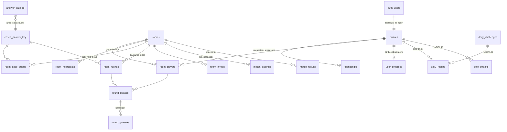
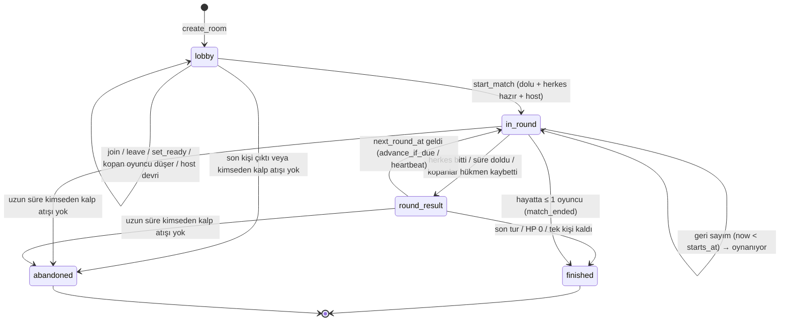
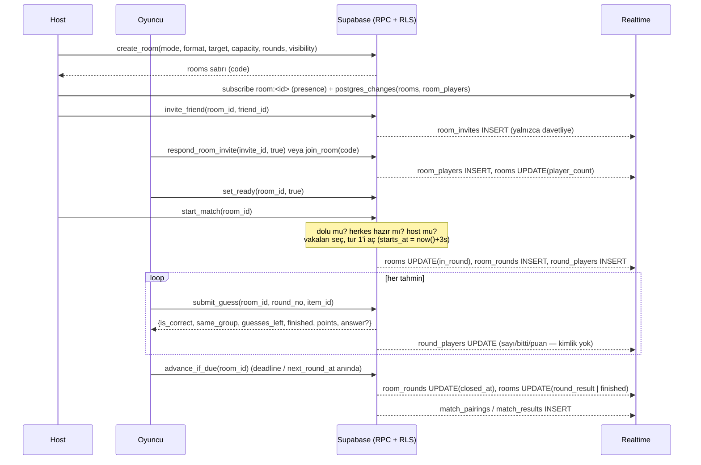

# PsikoVaka — Çevrimiçi katman tasarımı (Supabase)

Bu belge `migrations/0001_init.sql` dosyasının neyi, neden yaptığını anlatır ve istemci
(yeniden yazılacak `js/online_arena.js`) için sözleşmedir. Kurulum adımları `README.md`'de.

**Test durumu:** `tests/scenario.test.mjs` içindeki 44 senaryonun hepsi PGlite (PostgreSQL 18.6, WASM)
ve PostgreSQL 16.15 üzerinde geçti. Supabase'in sağladığı nesneler (`auth.users`, `auth.uid()`,
`realtime.messages`, `realtime.topic()`, roller, yayın) `tests/00_supabase_stubs.sql` ile taklit edildi.
Gerçek Supabase projesinde henüz çalıştırılmadı. Eşzamanlılık (iki isteğin aynı anda gelmesi)
kod düzeyinde satır kilitleriyle ele alındı ama ayrı bir yük/yarış testiyle denenmedi.

---

## 1. Temel ilkeler

- **Sunucu otoritesi.** İstemci hiçbir tabloya INSERT/DELETE yapamaz. Tek doğrudan yazma:
  `profiles.display_name` ve `profiles.avatar` (sütun düzeyinde yetki + RLS, yalnızca kendi satırı).
  Puan, tur sonucu, eleme, HP, RP, maç sonucu yalnızca `security definer` fonksiyonlarda hesaplanır.
- **Varsayılan red.** Her tabloda RLS açık. Politikası olmayan tablo istemciye kapalı
  (`cases_answer_key`, `answer_catalog`, `room_case_queue`, `room_heartbeats`, `daily_challenges`).
  Migration sonunda `anon` ve `authenticated` rollerinden her şey geri alınır, sonra yalnızca
  gerekenler verilir. `anon` hiçbir şeye erişemez (liderlik tablosu dahil — bkz. açık kararlar).
- **Fonksiyon güvenliği.** Hepsi `set search_path = ''`, her nesne şemasıyla yazılı.
  `_` ile başlayan fonksiyonlar iç kullanım içindir; istemciye `execute` yetkisi verilmez.
- **Yarış güvenliği.** Odayı değiştiren her RPC önce `select … from rooms … for update` ile oda
  satırını kilitler; aynı odaya gelen eşzamanlı istekler sıraya girer. Zamana bağlı geçişler
  (`_progress_room`) idempotenttir: kaç kez çağrılırsa çağrılsın aynı sonuca varır.
- **Silme yok.** Odadan ayrılma `left_at`, arkadaşlıktan çıkarma `status='removed'` ile işaretlenir.
  Neden: Supabase Realtime'da DELETE olayları filtrelenemiyor; güncelleme olayları ise RLS'e göre
  doğru kişilere gidiyor.
- **Ayarlar tek yerde:** `public.game_config` (anahtar/değer). Fonksiyonlar `_cfg('anahtar')` ile okur.

## 2. Veri modeli



| Tablo | Kim okur | Not |
|---|---|---|
| `profiles` | giriş yapmış herkes | `username` benzersiz (büyük/küçük harf duyarsız, `^[A-Za-z0-9_]{3,20}$`), `display_name` serbest (1–30), `avatar` jsonb (≤1 KB; istemci 2026-11-15'ten beri Nöro v2 yazar: `{v:2, body, color, tufts, eyes, mouth, pattern, headwear, accessory, background}`, eski `{bg,skin,hat,eye,mouth,prop}` okunurken eşlenir — bkz. `js/avatar.js`), `ranked_points` varsayılan 250 |
| `friendships` | yalnızca taraflar | çift başına tek satır; `pending → accepted / declined / removed` |
| `rooms` | üyeler; davetliler; herkese açık **lobideki** odalar | `code` 6 karakter (`ABCDEFGHJKMNPQRSTUVWXYZ23456789`), bitmemiş odalar arasında benzersiz |
| `room_players` | odaya bir kez girmiş olanlar | `left_at`, `is_ready`, `played`, `total_score`, `eliminated_round`, `hp`, `team` (hazırlık) |
| `room_heartbeats` | kimse (iç) | son görülme; sık yazıldığı için ayrı ve Realtime dışında |
| `room_case_queue` | kimse (iç) | start_match'te seçilen vakalar; gelecek turların vakası istemciye gitmez |
| `room_rounds` | üyeler | yalnızca başlamış turlar; `case_id`, `starts_at`, `deadline_at`, `closed_at`, `hp_multiplier`, `eliminated_user_ids` |
| `round_players` | üyeler | tahmin **sayısı**, aşama, bitti/kazandı, puan, süre, `finish_reason`, HP hasarı. Tahmin kimlikleri yok |
| `round_guesses` | sahibi; tur kapandıktan sonra odadakiler | tahmin edilen öğe kimlikleri |
| `match_pairings` | üyeler | bracket eşleşmeleri |
| `match_results` | sahibi + odadakiler | sıra, toplam puan, `rp_delta`, `rp_after` |
| `room_invites` | davet eden ve edilen | 10 dk geçerli |
| `user_progress` | sahibi | yerel ilerlemenin bir kerelik aktarımı |
| `cases_answer_key`, `answer_catalog` | kimse | seed dosyasından |
| `game_config` | giriş yapmış herkes | istemci HP/süre gibi değerleri gösterebilsin diye |
| `leaderboard` (görünüm) | giriş yapmış herkes | `position` = RP'ye göre `rank()` |
| `daily_results`, `daily_leaderboard`, `solo_streaks` | giriş yapmış herkes | HAZIRLIK — yazan RPC yok |

## 3. Oda modları ve formatlar (`rooms.mode` × `rooms.format`)

| mode | format | kapasite | tur sayısı | kural |
|---|---|---|---|---|
| `duel` | `rounds` | 2 | host seçer (1–15, varsayılan 5) | toplam puan |
| `duel` | `hp` | 2 | `hp_max_rounds` (10) | HP düellosu (aşağıda) |
| `ffa` | `rounds` | 2–8 | host seçer (1–15, varsayılan 5) | toplam puan |
| `tournament` | `battle` | 4 veya 8 | kapasite − 1 (4→3, 8→7) | herkes aynı vaka; her tur en düşük puanlı elenir (2 kişi kalana kadar) |
| `tournament` | `bracket` | 4 veya 8 | log2(kapasite) (4→2, 8→3) | tek eleme ağacı |

Hedef (`target_type`): `diagnosis | therapy | pharmacology | combo`. Herkese açık/özel: `visibility`.
Tur süresi: `round_time_limit_sec` (30–900; varsayılan 180, kombo 300).

### 3.1 Puan (calculateCasePoints ile birebir)
`taban(tahmin no) = {1:100, 2:85, 3:70, 4:55, 5:40, 6:25}` + `hız bonusu = clamp(round((60 − min(60, süre || 30)) / 3), 0, 20)`.
Kaybedilen turda 0. Süre = `now() − starts_at` (sunucu saati, tam saniyeye aşağı yuvarlanır).
JS'teki `|| 30` tuhaflığı korunuyor: 0. saniyede çözen 30 sn sayılır (bonus 10). Düzeltmek
istenirse yalnızca `_speed_bonus` değişir (açık karar).

**Kombo:** üç aşama (tanı → terapi → ilaç), aşama başına 6 hak. Bir aşamada 6 hak biterse tur
kaybedilir. Kazanılırsa puan = `round(ortalama(üç aşamanın tabanı)) + hız bonusu(toplam süre)`.
Mevcut istemci kombo puanını yalnızca 3. aşamanın tahmin sayısıyla hesaplıyordu; bu, 1. ve 2.
aşamadaki hataları ödüllendirdiği için değiştirildi (açık karar).

### 3.2 HP düellosu (`duel` + `hp`)
- İkisi de `hp_start` (600) ile başlar.
- Her tur sonunda düşük puanlı oyuncu `round((puan farkı) × çarpan)` HP kaybeder; eşitlikte hasar yok.
- Çarpan: tur < `hp_ramp_start_round` (4) ise `hp_multiplier_base` (1.0); sonra her tur
  `hp_multiplier_step` (0.5) eklenir → 1, 1, 1, 1.5, 2, 2.5, …
- Biri 0 HP'ye inince maç biter; `hp_max_rounds` (10) sonunda HP'si yüksek olan kazanır
  (eşitse toplam puan, sonra toplam çözme süresi).
- `round_players.hp_damage` / `hp_after` ve `room_rounds.hp_multiplier` animasyon için yayınlanır.

### 3.3 Turnuva — battle
Her tur sonunda hayatta (çıkmamış, elenmemiş) oyuncu sayısı > 2 ise en düşük tur puanlı elenir.
Eşitlikte: daha uzun süren (mevcut istemcideki gibi), sonra daha geç katılan. Elenen odada kalır,
izler, tahmin gönderemez (`NOT_IN_ROUND`). Son sıralama: elenmeyenler (toplam puana göre), sonra
geç elenenden erken elenene.

### 3.4 Turnuva — bracket
- **Tohumlama** (`bracket_seeding`): `random` veya `ranked` (RP'ye göre, eşitlikte rastgele).
  Standart yerleşim: 4 kişi `1–4, 2–3`; 8 kişi `1–8, 4–5, 3–6, 2–7` (1 ve 2 ancak finalde karşılaşır).
- Ağacın her turu bir `room_rounds` turudur; o turdaki **bütün eşleşmeler aynı vakayı aynı anda** oynar
  (tek maç, best-of-1). Bütün eşleşmeler bitince (veya süre/kopma ile karara bağlanınca) tur kapanır,
  kazananlar `slot/2` kuralıyla bir sonraki tura yerleşir.
- **Kazanan:** odada kalan > kopmamış (absent/left değil) > yüksek puan > az tahmin > kısa süre >
  erken bitiren > üst sıradaki (player_a). `decided_reason`: `score | tiebreak | forfeit`.
- Sıralama: şampiyon 1., finalist 2., sonra elenme turuna göre.
- İleride best-of-3 istenirse: `match_pairings`'e `games_a`, `games_b` ve tur başına birden çok
  `room_rounds` (alt tur) eklenmesi yeterli.

### 3.5 RP (maç sonunda, sunucuda, bir kez)
| durum | RP |
|---|---|
| 1. — turnuva (battle/bracket) | +75 |
| 1. — ffa | +50 |
| 1. — düello (rounds/hp) | +35 |
| 2. ve oyuncu sayısı > 2 | +20 |
| maçı tamamlayan diğerleri | +5 |
| maç sırasında odadan çıkan | 0 |

RP kaybı yok (mevcut oyunla aynı). Değerler `game_config`'te.
**Çifte ödeme koruması:** `match_results (room_id, user_id)` birincil anahtar + `on conflict do nothing`
+ `rp_after is null` koşulu + oda `finished` kontrolü. Test: bitirme fonksiyonu 3 kez çağrıldı, RP değişmedi.
**Çiftçilik koruması:** Rakipler çıktığı için erken biten maçta oynanan tur sayısı toplamın yarısından
azsa kimseye RP verilmez (`rooms.ended_early = true`). Aksi halde "ikinci hesapla katıl-çık" ile
dakikada +35 alınabilirdi. Tam maçları ikinci hesapla oynamak sunucu tarafında engellenemez.

## 4. Oda durum makinesi



Brifteki `starting` durumu ayrı bir enum değeri olarak tutulmadı: `status = 'in_round'` ve
`now() < room_rounds.starts_at` iken istemci geri sayım gösterir (her tur 3 sn, `round_countdown_sec`).
Böylece "starting → in_round" geçişi için kimsenin sunucuyu tetiklemesi gerekmiyor.

**Zaman geçişlerini kim tetikler?** Sunucuda zamanlayıcı yok. İstemciler:
- her **10 sn**'de `heartbeat(room_id)` çağırır (bu da `_progress_room`'u çalıştırır),
- `deadline_at` ve `next_round_at` anlarında `advance_if_due(room_id)` çağırır,
- `submit_guess` / `forfeit_round` / `leave_room` zaten sonunda ilerletir.
Odada bağlı tek bir kişi olması yeterli. Kimse bağlı değilse oda donar ve `stale_room_minutes` (10)
sonra `_close_stale_rooms()` (her `create_room`'da veya isteğe bağlı pg_cron) onu `abandoned` yapar
(RP yok).

**Kopma toleransı:** lobide 60 sn kalp atışı yoksa oyuncu odadan çıkarılır (host ise host devredilir);
maçta 30 sn yoksa o turu `absent` olarak 0 puanla kaybeder ama odada kalır, dönünce sonraki turu oynar.
Host'un yetkisi yalnızca lobide anlamlıdır; maçta host çıkarsa da devredilir.

## 5. Akışlar



## 6. Realtime sözleşmesi

### 6.1 Tablo değişiklikleri (`postgres_changes`)
Yayındaki tablolar: `friendships, room_invites, rooms, room_players, room_rounds, round_players,
match_pairings, match_results`. RLS'e göre süzülür: kişi yalnızca okuyabildiği satırların olaylarını alır.
`round_guesses`, `room_heartbeats`, cevap anahtarı yayında **değil**.

| Ekran | Dinlenecek | Filtre |
|---|---|---|
| Arkadaşlar | `friendships` (INSERT, UPDATE) | yok (RLS zaten yalnızca kendi satırlarını gönderir) |
| Davetler | `room_invites` (INSERT, UPDATE) | `invitee_id=eq.<benim id>` |
| Herkese açık lobi listesi | `rooms` (INSERT, UPDATE) | `visibility=eq.public` (+ istemcide `status='lobby'`) |
| Oda (lobi + maç) | `rooms` UPDATE | `id=eq.<room_id>` |
| | `room_players` * | `room_id=eq.<room_id>` |
| | `room_rounds` * | `room_id=eq.<room_id>` |
| | `round_players` * | `room_id=eq.<room_id>` |
| | `match_pairings` * | `room_id=eq.<room_id>` |
| | `match_results` INSERT/UPDATE | `room_id=eq.<room_id>` |

Olay kaçırılırsa (sekme uykuya geçti vb.) `get_room_state(room_id)` tam anlık görüntüyü döner;
yeniden bağlanınca bir kez çağrılmalı.

### 6.2 Özel kanallar (Broadcast / Presence)
Kanallar `supabase.channel('<ad>', { config: { private: true } })` ile açılır. Yetki
`realtime.messages` üzerindeki RLS politikasıyla `public.can_use_realtime_topic(topic, write)` fonksiyonundan gelir.

| Kanal | Okuma | Yazma (track/broadcast) | Amaç |
|---|---|---|---|
| `online:<user_id>` | sahibi + arkadaşları | yalnızca sahibi | çevrimiçi durumu |
| `room:<room_id>` | odadaki (ayrılmamış) oyuncular | aynı | lobi/maç presence, emoji |

Presence yükleri (istemci gönderir, **güvenilmez**; yalnızca görsel amaçlı):
```json
// online:<user_id>  — kullanıcı her sayfa açılışında kendi kanalına track eder
{ "user_id": "uuid", "status": "online | in_lobby | in_match", "room_id": "uuid | null", "at": "ISO-8601" }
// room:<room_id>
{ "user_id": "uuid", "typing": false, "at": "ISO-8601" }
// room:<room_id> broadcast event "emote"
{ "user_id": "uuid", "emote": "coffee | brain | dsm | lightning | organic" }
```
Arkadaş listesi için istemci her arkadaşın `online:<id>` kanalına abone olur (okuma). Arkadaş sayısı
çok büyürse (yüzlerce) bağlantı başına kanal sınırına takılabilir; o zaman `profiles.last_seen_at` +
periyodik sorgu alternatifine geçilir. Puan, hazır olma, kim kazandı gibi **hiçbir otoriter bilgi
Presence/Broadcast'ten okunmaz**; hepsi tablolardan gelir.

## 7. İstemci API sözleşmesi (RPC)

Çağrı: `const { data, error } = await supabase.rpc('ad', { p_...: ... })`.
Hata: `error.message` sabit koddur (aşağıda), `error.details` Türkçe açıklama. Bütün RPC'ler giriş gerektirir
(aksi halde `NOT_AUTHENTICATED`; anon rolü fonksiyonları hiç çağıramaz). Zaman damgaları sunucu saatidir;
istemci `server_time` ile kendi saat farkını hesaplayıp geri sayımı `starts_at` / `deadline_at`'e göre gösterir.

`room_brief` = `{ server_time, room_id, status, current_round, round_count, next_round_at, round: { round_no, case_id, starts_at, deadline_at, closed_at } | null }`

| RPC | Parametreler | Dönüş | Hatalar |
|---|---|---|---|
| `set_username` | `p_username text` | `profiles` satırı | `USERNAME_INVALID`, `USERNAME_TAKEN` |
| `send_friend_request` | `p_username text` | `{friendship_id, status}` (karşı taraf zaten istemişse `accepted`) | `USERNAME_REQUIRED`, `USER_NOT_FOUND`, `CANNOT_FRIEND_SELF`, `ALREADY_FRIENDS`, `TOO_MANY_REQUESTS` |
| `respond_friend_request` | `p_friendship_id uuid, p_accept bool` | `{friendship_id, status}` | `REQUEST_NOT_FOUND`, `FRIEND_LIMIT` |
| `remove_friend` | `p_user_id uuid` | `{friendship_id, status:'removed'}` (giden bekleyen isteği iptal de eder) | `NOT_FRIENDS` |
| `create_room` | `p_mode` (`duel/ffa/tournament`), `p_format?` (`rounds/hp/battle/bracket`; varsayılan duel/ffa→rounds, tournament→battle), `p_target_type?`='diagnosis', `p_capacity?`, `p_round_count?`, `p_visibility?`='private', `p_round_time_limit_sec?`, `p_bracket_seeding?`='random' | `rooms` satırı | `USERNAME_REQUIRED`, `INVALID_SETTINGS` (details: hangi alan), `NOT_ENOUGH_CASES`, `CODE_GENERATION_FAILED` |
| `join_room` | `p_code text` (büyük/küçük harf fark etmez) | `rooms` satırı (zaten üyeyse yeniden bağlanır) | `USERNAME_REQUIRED`, `ROOM_NOT_FOUND`, `ALREADY_STARTED`, `ROOM_FULL` |
| `leave_room` | `p_room_id uuid` | `{ok}` | `NOT_MEMBER` |
| `set_ready` | `p_room_id, p_ready bool` | `{ok, is_ready}` | `ROOM_NOT_FOUND`, `NOT_MEMBER`, `ALREADY_STARTED` |
| `start_match` | `p_room_id` | `room_brief` | `ROOM_NOT_FOUND`, `NOT_MEMBER`, `ALREADY_STARTED`, `NOT_HOST`, `ROOM_NOT_FULL`, `NOT_ALL_READY`, `NOT_ENOUGH_CASES` |
| `submit_guess` | `p_room_id, p_round_no int, p_item_id text` | `{round_no, stage, next_stage, guess_no, guesses_left, is_correct, same_group, stage_completed, finished, won, points, elapsed_sec, answer: {diagnosis_id, therapy_id, pharmacology_id} \| null, room: room_brief}` — `answer` yalnızca oyuncu bitince | `ROOM_NOT_FOUND`, `NOT_MEMBER`, `NOT_STARTED`, `ROUND_CLOSED`, `ROUND_NOT_STARTED`, `NOT_IN_ROUND`, `ALREADY_FINISHED`, `GUESS_LIMIT`, `UNKNOWN_ITEM`, `DUPLICATE_GUESS` |
| `forfeit_round` | `p_room_id, p_round_no` | `{finished, won:false, points:0, answer, room}` | `ROOM_NOT_FOUND`, `NOT_MEMBER`, `ROUND_CLOSED`, `ROUND_NOT_STARTED`, `ALREADY_FINISHED` |
| `heartbeat` | `p_room_id` | `room_brief` | `NOT_MEMBER` |
| `advance_if_due` | `p_room_id` | `room_brief` | `NOT_MEMBER` |
| `invite_friend` | `p_room_id, p_friend_id uuid` | `room_invites` satırı | `ROOM_NOT_FOUND`, `NOT_MEMBER`, `ALREADY_STARTED`, `ROOM_FULL`, `NOT_FRIENDS`, `ALREADY_IN_ROOM` |
| `respond_room_invite` | `p_invite_id, p_accept bool` | `{ok, status, room?}`; süresi geçmişse `{ok:false, error:'INVITE_EXPIRED'}` | `INVITE_NOT_FOUND` + `join_room` hataları |
| `get_room_state` | `p_room_id` | `{server_time, room, players[ {user_id, username, display_name, avatar, ranked_points, is_host, is_ready, joined_at, left_at, played, total_score, eliminated_round, hp, team} ], round, round_players[], my_guesses[], pairings[], results[]}` | `NOT_MEMBER` |
| `update_room_settings` (**0002**) | `p_room_id, p_target_type?, p_round_count?, p_visibility?, p_capacity?, p_round_time_limit_sec?` (null = değiştirme) | `rooms` satırı + `changed bool` | `ROOM_NOT_FOUND`, `NOT_MEMBER`, `ALREADY_STARTED`, `NOT_HOST`, `INVALID_SETTINGS` (details: alan), `NOT_ENOUGH_CASES` |
| `import_local_progress` | `p_solved_case_ids text[], p_stats jsonb` (`psikovaka_stats` biçimi) | `{ok, imported_case_count, ignored_case_count}` | `ALREADY_IMPORTED`, `INVALID_PROGRESS`, `INVALID_STATS` |

Doğrudan tablo erişimi (supabase-js `.from()`): yalnızca `select`, RLS'e tabi. Tek yazma:
`supabase.from('profiles').update({ display_name, avatar }).eq('id', myId)`.
Liderlik: `supabase.from('leaderboard').select('*').order('ranked_points', { ascending: false }).limit(10)`;
lig adı ve amblemi (`js/leagues.js`, `PsikoVakaLeagues.tierFor/badge`) istemcide hesaplanır.

**`submit_guess` notları:** `p_item_id` tanı/terapi/ilaç kimliğidir (`js/diagnoses.js` vb. `id`); kombo
modunda hangi tür beklendiğini sunucu `stage`'e göre belirler. `UNKNOWN_ITEM` ve `DUPLICATE_GUESS`
hak yemez. `same_group` = mevcut "sıcak" ipucu (aynı DSM kategorisi / terapi ekolü / ilaç ailesi).
`ROUND_CLOSED` (süre doldu) alındığında istemci `advance_if_due` çağırmalı.

**Yerel ilerleme aktarımı:** her hesap bir kez çağırabilir. `played/won/currentStreak/maxStreak` tam sayı,
`0 ≤ currentStreak ≤ maxStreak ≤ won ≤ played ≤ 100000`, `distribution` anahtarları `1..6`, toplamı `≤ won`.
Bilinmeyen vaka kimlikleri sessizce atlanır. **RP aktarılmaz**, gönderilen başka alanlar (ör. `rankedPoints`) yok sayılır;
herkes 250 RP ile başlar.

## 8. Güvenlik notları

- Tarayıcıya yalnızca publishable/anon anahtar konur. Secret/service_role anahtar bu sistemde hiçbir
  yerde gerekmiyor.
- İstemcinin gönderebildiği tek bilgi: hangi odaya/arkadaşa ne yaptığı ve tahmin ettiği öğe kimliği.
  Puan, süre, tur sonucu, eleme, HP, RP sunucuda hesaplanır; `UPDATE profiles set ranked_points` ve
  `UPDATE round_players set points` testte "permission denied" ile reddedildi.
- Süre sunucu saatiyle ölçülür; istemci saatini değiştirerek hız bonusu alınamaz.
- Oda kodu `gen_random_uuid()` baytlarından üretilir (kriptografik rastgele); özel oda kodunu bilen katılabilir —
  kod, özel odanın anahtarıdır.
- Davet yalnızca kabul edilmiş arkadaşa gönderilebilir ve yalnızca davet edilen ile eden görür.
- Arkadaşlık sınırları: bekleyen giden istek ≤ 50, arkadaş ≤ 200 (`game_config`). Reddedilen istek
  yeniden gönderilebilir (bekleme süresi yok; gerekirse eklenir).
- Yeni migration'larda: Supabase public şemasında yeni tablo/fonksiyonlara `anon`/`authenticated` için
  otomatik yetki verir. Her yeni migration, bu dosyadaki gibi kendi nesnelerinden yetkiyi geri almalı.

## 9. Bilinen sınırlama (dürüstçe)

Vaka metinleri **ve doğru cevapları** çevrimdışı oyun için hâlâ istemcideki JS dosyalarında
(`js/cases.js`). Maçta oynanan vakanın `case_id`'si tur başında herkese gönderilir (istemci ipuçlarını
kendi dosyasından gösterdiği için zorunlu). Kararlı biri tarayıcı konsolundan cevabı bulabilir.
Bu şema **sahte puanı ve sahte RP'yi** engeller (sunucu doğrular, sunucu hesaplar), **cevaba bakmayı engellemez**.

Sonraki seçenek (yapılmadı): yalnızca çevrimiçi kullanılan ayrı bir vaka havuzu. Bu vakaların
metinleri istemciye hiç gömülmez; sunucuda `online_cases(case_id, clues text[6], ...)` gibi bir tabloda
durur ve `get_round_clues(room_id)` benzeri bir RPC, yalnızca **açılmış** ipuçlarını
(tahmin sayısı + 1 kadar) döner. Böylece cevap ancak tahmin sonucu olarak öğrenilir. Bunun maliyeti:
o havuzun vakaları çevrimdışı oynanamaz, her ipucu açılışı bir ağ isteği olur ve vaka yazımı iki yerde
yönetilir.

## 10. HAZIRLIK: ileride eklenecekler (şemada yeri var, RPC yok)

- **2v2 takım düellosu:** `room_players.team smallint (1|2)`. Eklenecekler: `mode='team_duel'`, kapasite 4,
  lobide takım seçimi (`set_team` RPC), `_finish_match`'te takım toplamına göre sıralama, takım RP kuralı.
- **Günlük meydan okuma liderliği:** `daily_challenges(challenge_date, target_type, case_id)` günün vakasını
  sunucuda sabitler (şu an istemci kendisi seçiyor). `daily_results` kullanıcı × gün × hedef başına tek satır
  (birincil anahtar). `daily_leaderboard` görünümü günün sıralamasını verir. Eklenecek: `start_daily` /
  `submit_daily_guess` RPC'leri (oda yerine kullanıcıya bağlı bir "tek kişilik tur"; doğrulama ve puan
  `submit_guess` ile aynı fonksiyonlardan).
- **Tekli seri rekorları:** `solo_streaks(user_id, target_type, current_streak, best_streak)`. Güvenilir olması
  için seriler sunucuda doğrulanan tekli turlardan (günlük RPC'lerle aynı mekanizma) güncellenmeli;
  istemcinin "serim 40" demesi kabul edilmemeli.
- **Sınıf / parti modu (yapılmadı):** öğretim üyesi oynamayan bir moderatör olarak oda açar, ~40 öğrenci katılır.
  Gerekenler: `room_players.role` (`player | moderator | spectator`) — `_alive_count`, `round_players`
  oluşturma ve sıralama yalnızca `player` rolünü saymalı; `rooms_capacity_by_mode` kısıtına
  `mode='classroom' and capacity between 2 and 40`; `start_match` için "herkes hazır" yerine "moderatör başlatır";
  moderatöre turu erken kapatma / sonraki tura geçme RPC'si. Realtime yükü: 40 kişi × her tahminde
  `round_players` güncellemesi makul, ama Presence yerine yalnızca tablo olayları tercih edilmeli.

## 11. Açık kararlar (Emre)

1. **Tur süresi varsayılanı:** 180 sn (kombo 300 sn). Oyunun hız bonusu 60 sn'de bitiyor; daha kısa
   (ör. 120 sn) maçları hızlandırır.
2. **Herkese açık odalar:** şema destekliyor (`visibility='public'`). Açılacak mı, yoksa ilk sürümde
   yalnızca kod/davet mi?
3. **Liderlik tablosu giriş yapmamış ziyaretçiye açık mı?** Şu an hayır (anon hiçbir şey okuyamaz).
4. **Kombo puanı:** taban ortalaması (önerilen, uygulandı) mı, yoksa eski istemci davranışı mı?
5. **Battle finali:** son iki kişi toplam puanla mı (uygulandı, mevcut oyunla aynı) yoksa yalnızca
   final turunun puanıyla mı sıralansın?
6. **Bracket tohumlama varsayılanı:** `random` (uygulandı) mı `ranked` mı? Best-of-3 istenir mi?
7. **0. saniye tuhaflığı** (`|| 30`) düzeltilsin mi? Düzeltilirse istemcideki `calculateCasePoints` de değişmeli.
8. **Host hazır olmak zorunda mı?** Şu an host'un "Başlat"a basması kendi hazır onayı sayılıyor.
9. **Çevrimiçi kazanılan vakalar** `user_progress.solved_case_ids`'e eklensin mi? (Şu an eklenmiyor.)
10. **Erken biten maçta RP eşiği** (turların yarısı) uygun mu?

## 12. İstemci uygulaması (js/online/, ajan M, 2026-11-15) — sözleşmeye notlar

Uygulanan istemci bu belgeyi birebir izler; aşağıdakiler belgeyi netleştirir ya da ondan ayrılır.

- **0002_online_ek.sql** yalnızca `update_room_settings` ekler (lobide host ayar değiştirir; değişince diğerlerinin
  `is_ready` değeri sıfırlanır; kapasite mevcut oyuncu sayısının altına inemez; battle/bracket tur sayısı kapasiteden
  yeniden hesaplanır; süre açıkça verilmezse ve eski hedefin varsayılanındaysa yeni hedefin varsayılanına geçer).
  Tablo/politika/yayın değişikliği yok, tekrar çalıştırılabilir. İstemci fonksiyonu bulamazsa (PostgREST `PGRST202`)
  ayar sayfasını salt okunur + "yakında" notuyla gösterir; geri kalan her şey 0001 ile çalışır. Senaryo testleri: 46/46.
- **Herkese açık oda listesi** RPC gerektirmez: `rooms` RLS'i `visibility='public' and status='lobby'` satırlarını okutuyor;
  host adı `host:profiles!rooms_host_id_fkey(username,avatar)` gömmesiyle alınır. Liste `rooms` postgres_changes
  (`visibility=eq.public`) + 20 sn yoklama ile tazelenir (oda `in_round`'a geçince RLS yüzünden UPDATE olayı gelmeyebilir).
- **Rövanş** için migration gerekmedi: final ekranında "Lobiye dön" aynı ayarlarla yeni oda kurar, eski `room:<id>`
  kanalına `rematch {code, username, avatar}` yayını yapar (bitmiş odada `left_at` null kaldığı için kanal yetkisi sürer),
  arkadaş olan oyuncuları `invite_friend` ile çağırır; diğerleri final ekranındaki "Katıl" düğmesiyle gelir.
- **Kalp atışı ve geçişler:** 10 sn'de bir `heartbeat`; `deadline_at` ve `next_round_at` anında (+0,15–0,65 sn rastgele)
  `advance_if_due`; geçiş olmadıysa (saat farkı) 1,5 sn sonra yeniden. Sekme görünür olunca ve `online` olayında
  `heartbeat` + `get_room_state`. Sunucu saat farkı her RPC yanıtındaki `server_time`'dan (en kısa gidiş-dönüşlü örnek).
- **Uzlaştırma:** gerçeğin tek kaynağı `get_room_state`. `round_players` olayları tekdüze yama olarak uygulanır
  (bitmiş satır bitmemişe dönemez, tahmin sayısı azalamaz; aksi halde yeniden okunur); diğer tablo olayları 180 ms
  gecikmeli yeniden okumayı tetikler; `rooms` üzerinde durum/tur/host/next_round_at değişimi hemen yeniden okutur.
  Eski yanıtlar istek sıra numarasıyla atılır.
- **Presence yükleri** (§6.2'den farklı, yalnızca görsel): `online:<id>` → `{user_id, status: online|in_lobby|in_match, room_id, at}`;
  `room:<id>` → `{user_id, x, y, at}` (lobi sahnesinde konum, 0–1). Broadcast olayları: `move {user_id,x,y}` (≤ 3/sn),
  `emote {user_id, emote: wave|cheer|think|sad|laugh}` (Nöro duyguları; §6.2'deki coffee/brain/... listesi kullanılmadı),
  `say {user_id, key: ready|wait|gg|go|gj|rematch}` (yalnızca hazır mesajlar, serbest yazı yok), `rematch`.
  İstemcide hız sınırı: duygu 4/6 sn, mesaj 3/6 sn.
- **Kombo:** istemci `submit_guess` yanıtındaki `stage`/`next_stage`'i izler; ipucu sayısı = 1 + turdaki tüm yanlışlar (yerel motorla aynı).
- **Cevap anahtarı uyumu:** istemci, sunucunun seçtiği `case_id` yerelde yoksa ("Vaka bulunamadı" ekranı + "Bu turu pas geç")
  ya da yerelde doğru olan tahmin sunucuda yanlış sayılırsa / bitişte dönen `answer` yerel cevaptan farklıysa konsola
  `CEVAP ANAHTARI UYUŞMAZLIĞI` yazar (`PsikoVakaOnline.match.keyIssues`). 2026-11-15 canlı testinde iki durum da görüldü
  (canlı anahtar ajan J temizliğinden önceki sürüm): bkz. AI_ISBIRLIGI.md günlüğü.
- **Açık kararlar §11 için istemci varsayılanları:** herkese açık odalar açık (oda kurarken seçilir, varsayılan özel);
  host'un "Başlat"ı kendi hazır onayı (§11.8 aynen); çevrimiçi çözülen vakalar yerel "çözüldü" listesine ve yerel
  istatistiklere yazılmaz.
